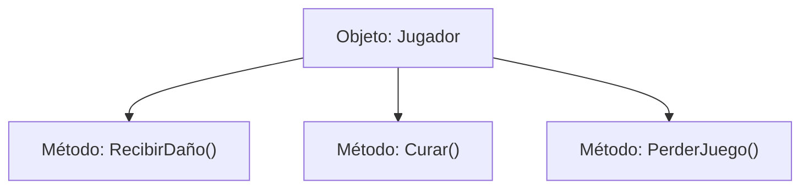

# 📦 Nodo Objeto Conceptual: `Jugador`

[[Index|⬅️ Índice]] | Fichero Origen: [[ejemplos_eligejuego_mpl|📄 ejemplos/eligejuego.mpl]]

## ⚙️ Estado y Propiedades
* **`salud`**: `100`
* **`llaves_obtenidas`**: `0`
* **`inventario`**: `PILA`
* **`modulo_cronal_activo`**: `True`

## 🛠️ Métodos e Instrucciones Concretas Línea por Línea
### Método `RecibirDaño()`
| N° | Instrucción Concreta | Explicación Semántica | 'man' Ficha |
| :--- | :--- | :--- | :--- |
| `1` | `ESTADO.salud = 70` | Mutación o llamada interna | Operador de acceso y mutación al estado interno del objeto conceptual activo. Garantiza aislamiento en la gestión del dominio. |
| `2` | `MOSTRAR "Has sufrido daño. Salud actual reducida."` | Mutación o llamada interna | Imprime una salida formateada de texto en las consolas o terminales de trazado en tiempo real de los drivers de UI. |
### Método `Curar()`
| N° | Instrucción Concreta | Explicación Semántica | 'man' Ficha |
| :--- | :--- | :--- | :--- |
| `1` | `ESTADO.salud = 100` | Mutación o llamada interna | Operador de acceso y mutación al estado interno del objeto conceptual activo. Garantiza aislamiento en la gestión del dominio. |
| `2` | `MOSTRAR "Te has recuperado por completo."` | Mutación o llamada interna | Imprime una salida formateada de texto en las consolas o terminales de trazado en tiempo real de los drivers de UI. |
### Método `PerderJuego()`
| N° | Instrucción Concreta | Explicación Semántica | 'man' Ficha |
| :--- | :--- | :--- | :--- |
| `1` | `ESTADO.salud = 0` | Mutación o llamada interna | Operador de acceso y mutación al estado interno del objeto conceptual activo. Garantiza aislamiento en la gestión del dominio. |
| `2` | `MOSTRAR "Tu línea temporal se ha extinguido."` | Mutación o llamada interna | Imprime una salida formateada de texto en las consolas o terminales de trazado en tiempo real de los drivers de UI. |

## 📊 Diagrama de Estructura Interna (Mermaid)

