# 🗺️ Arquitectura e Índice de Bóveda Atómica: `mpl_runtime`

Bóveda navegable interactiva desglosada **instrucción por instrucción** con manual `man` e informe de seguridad.

🛡️ [[Seguridad_y_Enjaulamiento|Ver Modelo de Seguridad y Sanitización de Argumentos]]

## 📁 Ficheros del Proyecto
* [[fuente_mpl_runtime-code_01_sanitizer_mpl|📄 fuente/mpl_runtime-code/01_sanitizer.mpl]] — *🧩 Módulo*
* [[fuente_mpl_runtime-code_02_spec_generator_mpl|📄 fuente/mpl_runtime-code/02_spec_generator.mpl]] — *🧩 Módulo*
* [[fuente_mpl_runtime-code_03_parser_mpl|📄 fuente/mpl_runtime-code/03_parser.mpl]] — *🧩 Módulo*
* [[fuente_mpl_runtime-code_04_vault_generator_mpl|📄 fuente/mpl_runtime-code/04_vault_generator.mpl]] — *🧩 Módulo*
* [[fuente_mpl_runtime-code_05_asset_manager_mpl|📄 fuente/mpl_runtime-code/05_asset_manager.mpl]] — *🧩 Módulo*
* [[fuente_mpl_runtime-code_06_runtime_engine_mpl|📄 fuente/mpl_runtime-code/06_runtime_engine.mpl]] — *🧩 Módulo*
* [[fuente_mpl_runtime-code_07_funciones_c1_mpl|📄 fuente/mpl_runtime-code/07_funciones_c1.mpl]] — *🧩 Módulo*
* [[fuente_mpl_runtime_mpl|📄 fuente/mpl_runtime.mpl]] — *🏰 Fachada Principal*

## 🖥️ Nodos Capa 3: Pantallas
* [[Pantalla_SelectorModoRuntime|📺 SelectorModoRuntime]] *(Origen: fuente/mpl_runtime.mpl)*

## 🧱 Nodos Capa 2: Objetos Conceptuales
* [[Objeto_MPLParser|📦 MPLParser]] *(Origen: fuente/mpl_runtime-code/04_vault_generator.mpl)*
* [[Objeto_MPLRuntimeEngine|📦 MPLRuntimeEngine]] *(Origen: fuente/mpl_runtime-code/06_runtime_engine.mpl)*
* [[Objeto_MPLSanitizer|📦 MPLSanitizer]] *(Origen: fuente/mpl_runtime-code/01_sanitizer.mpl)*
* [[Objeto_MPLSpecDocGenerator|📦 MPLSpecDocGenerator]] *(Origen: fuente/mpl_runtime-code/02_spec_generator.mpl)*
* [[Objeto_VaultGenerator|📦 VaultGenerator]] *(Origen: fuente/mpl_runtime-code/05_asset_manager.mpl)*

## ⚙️ Nodos Capa 1: Funciones
* [[Funcion_InicializarSistemaSelfHosting|🛠️ InicializarSistemaSelfHosting]] *(Origen: fuente/mpl_runtime-code/07_funciones_c1.mpl)*
* [[Funcion_RegistrarLogKernel|🛠️ RegistrarLogKernel]] *(Origen: fuente/mpl_runtime-code/07_funciones_c1.mpl)*
* [[Funcion_ValidarEntornoEjecucion|🛠️ ValidarEntornoEjecucion]] *(Origen: fuente/mpl_runtime-code/07_funciones_c1.mpl)*

## 📊 Diagrama Topológico General (Mermaid)

```mermaid
graph TD
    fuente_mpl_runtime_mpl["mpl_runtime.mpl"]
    fuente_mpl_runtime_mpl -->|IMPORTAR| fuente_mpl_runtime-code_01_sanitizer_mpl
    fuente_mpl_runtime_mpl -->|IMPORTAR| fuente_mpl_runtime-code_02_spec_generator_mpl
    fuente_mpl_runtime_mpl -->|IMPORTAR| fuente_mpl_runtime-code_03_parser_mpl
    fuente_mpl_runtime_mpl -->|IMPORTAR| fuente_mpl_runtime-code_04_vault_generator_mpl
    fuente_mpl_runtime_mpl -->|IMPORTAR| fuente_mpl_runtime-code_05_asset_manager_mpl
    fuente_mpl_runtime_mpl -->|IMPORTAR| fuente_mpl_runtime-code_06_runtime_engine_mpl
    fuente_mpl_runtime_mpl -->|IMPORTAR| fuente_mpl_runtime-code_07_funciones_c1_mpl
    fuente_mpl_runtime-code_01_sanitizer_mpl["01_sanitizer.mpl"]
    fuente_mpl_runtime-code_02_spec_generator_mpl["02_spec_generator.mpl"]
    fuente_mpl_runtime-code_03_parser_mpl["03_parser.mpl"]
    fuente_mpl_runtime-code_04_vault_generator_mpl["04_vault_generator.mpl"]
    fuente_mpl_runtime-code_05_asset_manager_mpl["05_asset_manager.mpl"]
    fuente_mpl_runtime-code_06_runtime_engine_mpl["06_runtime_engine.mpl"]
    fuente_mpl_runtime-code_07_funciones_c1_mpl["07_funciones_c1.mpl"]
```

