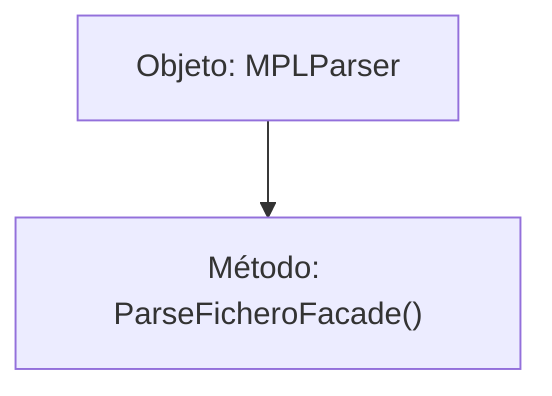

# 📦 Nodo Objeto Conceptual: `MPLParser`

[[Index|⬅️ Índice]] | Fichero Origen: [[fuente_mpl_runtime-code_04_vault_generator_mpl|📄 fuente/mpl_runtime-code/04_vault_generator.mpl]]

## ⚙️ Estado y Propiedades
* **`ruta_facade_activa`**: ``
* **`codigo_fuente_facade`**: ``
* **`pila_lineas_codigo`**: `PILA`
* **`linea_cursor`**: ``
* **`pila_pantallas_ast`**: `PILA`
* **`pila_objetos_ast`**: `PILA`
* **`pila_funciones_ast`**: `PILA`
* **`es_linea_pantalla`**: `False`
* **`es_linea_objeto`**: `False`
* **`es_linea_funcion`**: `False`
* **`es_linea_importar`**: `False`
* **`ruta_salida_grafo`**: ``
* **`grafo_json_salida`**: ``

## 🛠️ Métodos e Instrucciones Concretas Línea por Línea
### Método `ParseFicheroFacade()`
| N° | Instrucción Concreta | Explicación Semántica | 'man' Ficha |
| :--- | :--- | :--- | :--- |
| `1` | `ESTADO.ruta_facade_activa = ruta_fichero` | Mutación o llamada interna | Operador de acceso y mutación al estado interno del objeto conceptual activo. Garantiza aislamiento en la gestión del dominio. |
| `2` | `LEER_ARCHIVO(ESTADO.ruta_facade_activa, codigo_fuente_facade)` | Mutación o llamada interna | Operador de acceso y mutación al estado interno del objeto conceptual activo. Garantiza aislamiento en la gestión del dominio. |
| `3` | `DIVIDIR_CADENA(ESTADO.codigo_fuente_facade, "\n", pila_lineas_codigo)` | Mutación o llamada interna | Operador de acceso y mutación al estado interno del objeto conceptual activo. Garantiza aislamiento en la gestión del dominio. |
| `4` | `MOSTRAR "[Parser AST] Leyendo y tokenizando fichero objetivo a la PILA de líneas..."` | Mutación o llamada interna | Imprime una salida formateada de texto en las consolas o terminales de trazado en tiempo real de los drivers de UI. |
| `5` | `MIENTRAS ESTADO.pila_lineas_codigo HASTA` | Mutación o llamada interna | Operador de acceso y mutación al estado interno del objeto conceptual activo. Garantiza aislamiento en la gestión del dominio. |
| `6` | `ESTADO.pila_lineas_codigo.DESAPILAR()` | Mutación o llamada interna | Operador de acceso y mutación al estado interno del objeto conceptual activo. Garantiza aislamiento en la gestión del dominio. |
| `7` | `CONTIENE_CADENA(ESTADO.linea_cursor, "PANTALLA ", ESTADO.es_linea_pantalla)` | Mutación o llamada interna | Declara una vista o componente de la interfaz de usuario. Contiene un encabezado visual y un conjunto de opciones o eventos interactivos. |
| `8` | `CONTIENE_CADENA(ESTADO.linea_cursor, "OBJETO_CONCEPTUAL ", ESTADO.es_linea_objeto)` | Mutación o llamada interna | Define una entidad conceptual con estado encapsulado. Agrupa bloques de PROPIEDADES mutables e INTERACCIONES (métodos). |
| `9` | `CONTIENE_CADENA(ESTADO.linea_cursor, "FUNCION ", ESTADO.es_linea_funcion)` | Mutación o llamada interna | Operador de acceso y mutación al estado interno del objeto conceptual activo. Garantiza aislamiento en la gestión del dominio. |
| `10` | `CONTIENE_CADENA(ESTADO.linea_cursor, "IMPORTAR ", ESTADO.es_linea_importar)` | Mutación o llamada interna | Carga dinámicamente un módulo MPL. Exige que el fichero resida en la subcarpeta acotada <facade>-code/, ./fuente/ o ./ejemplos/ y resuelve sus dependencias de forma recursiva. |
| `11` | `MIENTRAS ESTADO.es_linea_pantalla HASTA` | Mutación o llamada interna | Operador de acceso y mutación al estado interno del objeto conceptual activo. Garantiza aislamiento en la gestión del dominio. |
| `12` | `ESTADO.pila_pantallas_ast.APILAR(ESTADO.linea_cursor)` | Mutación o llamada interna | Operador de acceso y mutación al estado interno del objeto conceptual activo. Garantiza aislamiento en la gestión del dominio. |
| `13` | `ESTADO.es_linea_pantalla = Falso` | Mutación o llamada interna | Operador de acceso y mutación al estado interno del objeto conceptual activo. Garantiza aislamiento en la gestión del dominio. |
| `14` | `FIN_MIENTRAS` | Mutación o llamada interna | Bucle condicional iterativo de bajo nivel para procesamiento de archivos, listas y parsing atómico de estructuras AST. |
| `15` | `MIENTRAS ESTADO.es_linea_objeto HASTA` | Mutación o llamada interna | Operador de acceso y mutación al estado interno del objeto conceptual activo. Garantiza aislamiento en la gestión del dominio. |
| `16` | `ESTADO.pila_objetos_ast.APILAR(ESTADO.linea_cursor)` | Mutación o llamada interna | Operador de acceso y mutación al estado interno del objeto conceptual activo. Garantiza aislamiento en la gestión del dominio. |
| `17` | `ESTADO.es_linea_objeto = Falso` | Mutación o llamada interna | Operador de acceso y mutación al estado interno del objeto conceptual activo. Garantiza aislamiento en la gestión del dominio. |
| `18` | `FIN_MIENTRAS` | Mutación o llamada interna | Bucle condicional iterativo de bajo nivel para procesamiento de archivos, listas y parsing atómico de estructuras AST. |
| `19` | `MIENTRAS ESTADO.es_linea_funcion HASTA` | Mutación o llamada interna | Operador de acceso y mutación al estado interno del objeto conceptual activo. Garantiza aislamiento en la gestión del dominio. |
| `20` | `ESTADO.pila_funciones_ast.APILAR(ESTADO.linea_cursor)` | Mutación o llamada interna | Operador de acceso y mutación al estado interno del objeto conceptual activo. Garantiza aislamiento en la gestión del dominio. |
| `21` | `ESTADO.es_linea_funcion = Falso` | Mutación o llamada interna | Operador de acceso y mutación al estado interno del objeto conceptual activo. Garantiza aislamiento en la gestión del dominio. |
| `22` | `FIN_MIENTRAS` | Mutación o llamada interna | Bucle condicional iterativo de bajo nivel para procesamiento de archivos, listas y parsing atómico de estructuras AST. |
| `23` | `FIN_MIENTRAS` | Mutación o llamada interna | Bucle condicional iterativo de bajo nivel para procesamiento de archivos, listas y parsing atómico de estructuras AST. |
| `24` | `REEMPLAZAR_TEXTO(ESTADO.ruta_facade_activa, ".mpl", ".graph.json", ruta_salida_grafo)` | Mutación o llamada interna | Operador de acceso y mutación al estado interno del objeto conceptual activo. Garantiza aislamiento en la gestión del dominio. |
| `25` | `ESTADO.grafo_json_salida = "{\n  \"status\": \"parsed_and_validated\"\n}"` | Mutación o llamada interna | Operador de acceso y mutación al estado interno del objeto conceptual activo. Garantiza aislamiento en la gestión del dominio. |
| `26` | `ESCRIBIR_ARCHIVO(ESTADO.ruta_salida_grafo, ESTADO.grafo_json_salida)` | Mutación o llamada interna | Operador de acceso y mutación al estado interno del objeto conceptual activo. Garantiza aislamiento en la gestión del dominio. |
| `27` | `MOSTRAR "[Compilador Grafo] Grafo AST exportado dinámicamente según la fachada activa."` | Mutación o llamada interna | Imprime una salida formateada de texto en las consolas o terminales de trazado en tiempo real de los drivers de UI. |

## 📊 Diagrama de Estructura Interna (Mermaid)

