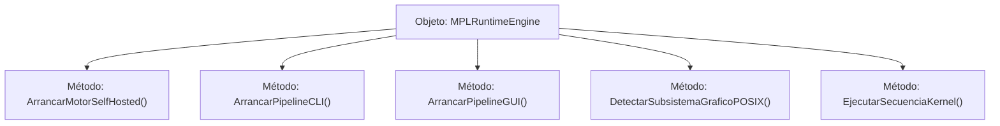

# 📦 Nodo Objeto Conceptual: `MPLRuntimeEngine`

[[Index|⬅️ Índice]] | Fichero Origen: [[fuente_mpl_runtime-code_06_runtime_engine_mpl|📄 fuente/mpl_runtime-code/06_runtime_engine.mpl]]

## ⚙️ Estado y Propiedades
* **`cola_eventos`**: `PILA`
* **`vista_activa`**: `SelectorModoRuntime`
* **`ejecutando_loop`**: `True`
* **`ui_driver_type`**: `CLI`
* **`driver_real_activo`**: `POSIX_CLI`
* **`soporte_x11_detectado`**: `False`
* **`buffer_entorno_posix`**: ``
* **`total_eventos_procesados`**: `0`
* **`ruta_script_objetivo`**: ``
* **`es_programa_valido`**: `False`

## 🛠️ Métodos e Instrucciones Concretas Línea por Línea
### Método `ArrancarMotorSelfHosted()`
| N° | Instrucción Concreta | Explicación Semántica | 'man' Ficha |
| :--- | :--- | :--- | :--- |
| `1` | `ESTADO.ui_driver_type = "CLI"` | Mutación o llamada interna | Operador de acceso y mutación al estado interno del objeto conceptual activo. Garantiza aislamiento en la gestión del dominio. |
| `2` | `ESTADO.driver_real_activo = "POSIX_CLI"` | Mutación o llamada interna | Operador de acceso y mutación al estado interno del objeto conceptual activo. Garantiza aislamiento en la gestión del dominio. |
| `3` | `ESTADO.ruta_script_objetivo = ARGUMENTOS.PRIMERO` | Mutación o llamada interna | Operador de acceso y mutación al estado interno del objeto conceptual activo. Garantiza aislamiento en la gestión del dominio. |
| `4` | `CONTIENE_CADENA(ESTADO.ruta_script_objetivo, ".mpl", ESTADO.es_programa_valido)` | Mutación o llamada interna | Operador de acceso y mutación al estado interno del objeto conceptual activo. Garantiza aislamiento en la gestión del dominio. |
| `5` | `MOSTRAR "============================================================"` | Mutación o llamada interna | Imprime una salida formateada de texto en las consolas o terminales de trazado en tiempo real de los drivers de UI. |
| `6` | `MOSTRAR " [MPL SELF-HOSTED RUNTIME v0.1.5] - ENTORNO NATIVO .MPL"` | Mutación o llamada interna | Imprime una salida formateada de texto en las consolas o terminales de trazado en tiempo real de los drivers de UI. |
| `7` | `MOSTRAR " Modo Interpretado: Consola Directa (CLI)"` | Mutación o llamada interna | Imprime una salida formateada de texto en las consolas o terminales de trazado en tiempo real de los drivers de UI. |
| `8` | `MOSTRAR " Programa Objetivo Detectado:"` | Mutación o llamada interna | Imprime una salida formateada de texto en las consolas o terminales de trazado en tiempo real de los drivers de UI. |
| `9` | `MOSTRAR ESTADO.ruta_script_objetivo` | Mutación o llamada interna | Operador de acceso y mutación al estado interno del objeto conceptual activo. Garantiza aislamiento en la gestión del dominio. |
| `10` | `MOSTRAR "============================================================"` | Mutación o llamada interna | Imprime una salida formateada de texto en las consolas o terminales de trazado en tiempo real de los drivers de UI. |
| `11` | `ESTADO.cola_eventos.APILAR(ESTADO.ruta_script_objetivo)` | Mutación o llamada interna | Operador de acceso y mutación al estado interno del objeto conceptual activo. Garantiza aislamiento en la gestión del dominio. |
| `12` | `ESTADO.total_eventos_procesados = 1` | Mutación o llamada interna | Operador de acceso y mutación al estado interno del objeto conceptual activo. Garantiza aislamiento en la gestión del dominio. |
| `13` | `EJECUTAR_PROGRAMA(ESTADO.ruta_script_objetivo)` | Mutación o llamada interna | Operador de acceso y mutación al estado interno del objeto conceptual activo. Garantiza aislamiento en la gestión del dominio. |
### Método `ArrancarPipelineCLI()`
| N° | Instrucción Concreta | Explicación Semántica | 'man' Ficha |
| :--- | :--- | :--- | :--- |
| `1` | `ESTADO.ui_driver_type = "CLI"` | Mutación o llamada interna | Operador de acceso y mutación al estado interno del objeto conceptual activo. Garantiza aislamiento en la gestión del dominio. |
| `2` | `ESTADO.driver_real_activo = "POSIX_CLI"` | Mutación o llamada interna | Operador de acceso y mutación al estado interno del objeto conceptual activo. Garantiza aislamiento en la gestión del dominio. |
| `3` | `MOSTRAR "[Runtime POSIX] Driver seleccionado: Consola Estándar (CLI)."` | Mutación o llamada interna | Imprime una salida formateada de texto en las consolas o terminales de trazado en tiempo real de los drivers de UI. |
| `4` | `DISPARAR EjecutarSecuenciaKernel` | Mutación o llamada interna | Emite un evento al Event Loop asíncrono FIFO para notificar cambios de estado u ordenar acciones reactivas en otros componentes. |
### Método `ArrancarPipelineGUI()`
| N° | Instrucción Concreta | Explicación Semántica | 'man' Ficha |
| :--- | :--- | :--- | :--- |
| `1` | `ESTADO.ui_driver_type = "GUI"` | Mutación o llamada interna | Operador de acceso y mutación al estado interno del objeto conceptual activo. Garantiza aislamiento en la gestión del dominio. |
| `2` | `MOSTRAR "[Runtime POSIX] Solicitado modo Ventana. Comprobando subsistema gráfico sobre POSIX..."` | Mutación o llamada interna | Imprime una salida formateada de texto en las consolas o terminales de trazado en tiempo real de los drivers de UI. |
| `3` | `DISPARAR DetectarSubsistemaGraficoPOSIX` | Mutación o llamada interna | Emite un evento al Event Loop asíncrono FIFO para notificar cambios de estado u ordenar acciones reactivas en otros componentes. |
### Método `DetectarSubsistemaGraficoPOSIX()`
| N° | Instrucción Concreta | Explicación Semántica | 'man' Ficha |
| :--- | :--- | :--- | :--- |
| `1` | `LEER_ARCHIVO("/proc/self/environ", buffer_entorno_posix)` | Mutación o llamada interna | Lee el contenido íntegro de un archivo dentro de las zonas enjauladas del espacio de trabajo y lo almacena en la propiedad de destino. |
| `2` | `CONTIENE_CADENA(ESTADO.buffer_entorno_posix, "DISPLAY=", ESTADO.soporte_x11_detectado)` | Mutación o llamada interna | Operador de acceso y mutación al estado interno del objeto conceptual activo. Garantiza aislamiento en la gestión del dominio. |
| `3` | `MIENTRAS ESTADO.soporte_x11_detectado HASTA` | Mutación o llamada interna | Operador de acceso y mutación al estado interno del objeto conceptual activo. Garantiza aislamiento en la gestión del dominio. |
| `4` | `ESTADO.driver_real_activo = "POSIX_X11_BRIDGE"` | Mutación o llamada interna | Operador de acceso y mutación al estado interno del objeto conceptual activo. Garantiza aislamiento en la gestión del dominio. |
| `5` | `MOSTRAR "[Runtime POSIX] Servidor gráfico X11 detectado en entorno. Enlazando driver de ventana..."` | Mutación o llamada interna | Imprime una salida formateada de texto en las consolas o terminales de trazado en tiempo real de los drivers de UI. |
| `6` | `ESTADO.soporte_x11_detectado = Falso` | Mutación o llamada interna | Operador de acceso y mutación al estado interno del objeto conceptual activo. Garantiza aislamiento en la gestión del dominio. |
| `7` | `FIN_MIENTRAS` | Mutación o llamada interna | Bucle condicional iterativo de bajo nivel para procesamiento de archivos, listas y parsing atómico de estructuras AST. |
| `8` | `CONTIENE_CADENA(ESTADO.driver_real_activo, "POSIX_CLI", ESTADO.soporte_x11_detectado)` | Mutación o llamada interna | Operador de acceso y mutación al estado interno del objeto conceptual activo. Garantiza aislamiento en la gestión del dominio. |
| `9` | `MIENTRAS ESTADO.soporte_x11_detectado HASTA` | Mutación o llamada interna | Operador de acceso y mutación al estado interno del objeto conceptual activo. Garantiza aislamiento en la gestión del dominio. |
| `10` | `MOSTRAR "[Runtime POSIX] Aviso: Estándar POSIX sin servidor de ventanas activo."` | Mutación o llamada interna | Imprime una salida formateada de texto en las consolas o terminales de trazado en tiempo real de los drivers de UI. |
| `11` | `MOSTRAR "[Runtime POSIX] Aplicando fallback automático -> Ejecutando en modo CLI estándar."` | Mutación o llamada interna | Imprime una salida formateada de texto en las consolas o terminales de trazado en tiempo real de los drivers de UI. |
| `12` | `ESTADO.ui_driver_type = "CLI"` | Mutación o llamada interna | Operador de acceso y mutación al estado interno del objeto conceptual activo. Garantiza aislamiento en la gestión del dominio. |
| `13` | `ESTADO.soporte_x11_detectado = Falso` | Mutación o llamada interna | Operador de acceso y mutación al estado interno del objeto conceptual activo. Garantiza aislamiento en la gestión del dominio. |
| `14` | `FIN_MIENTRAS` | Mutación o llamada interna | Bucle condicional iterativo de bajo nivel para procesamiento de archivos, listas y parsing atómico de estructuras AST. |
| `15` | `DISPARAR EjecutarSecuenciaKernel` | Mutación o llamada interna | Emite un evento al Event Loop asíncrono FIFO para notificar cambios de estado u ordenar acciones reactivas en otros componentes. |
### Método `EjecutarSecuenciaKernel()`
| N° | Instrucción Concreta | Explicación Semántica | 'man' Ficha |
| :--- | :--- | :--- | :--- |
| `1` | `MOSTRAR "[Cargador MPL] Iniciando pipeline secuencial automático..."` | Mutación o llamada interna | Imprime una salida formateada de texto en las consolas o terminales de trazado en tiempo real de los drivers de UI. |
| `2` | `MOSTRAR "[1/5] Validando ruta y enjaulamiento Sandbox..."` | Mutación o llamada interna | Imprime una salida formateada de texto en las consolas o terminales de trazado en tiempo real de los drivers de UI. |
| `3` | `MOSTRAR "[2/5] Generando Bóveda de Especificación Oficial y Skill IA..."` | Mutación o llamada interna | Imprime una salida formateada de texto en las consolas o terminales de trazado en tiempo real de los drivers de UI. |
| `4` | `MOSTRAR "[3/5] Parseando Fichero Fachada (.mpl) y construyendo AST..."` | Mutación o llamada interna | Imprime una salida formateada de texto en las consolas o terminales de trazado en tiempo real de los drivers de UI. |
| `5` | `MOSTRAR "[4/5] Exportando Grafo JSON y Bóveda Obsidian Atómica..."` | Mutación o llamada interna | Imprime una salida formateada de texto en las consolas o terminales de trazado en tiempo real de los drivers de UI. |
| `6` | `ESTADO.cola_eventos.APILAR("RENDER_PANTALLA_INICIAL")` | Mutación o llamada interna | Declara una vista o componente de la interfaz de usuario. Contiene un encabezado visual y un conjunto de opciones o eventos interactivos. |
| `7` | `ESTADO.ejecutando_loop = Verdadero` | Mutación o llamada interna | Operador de acceso y mutación al estado interno del objeto conceptual activo. Garantiza aislamiento en la gestión del dominio. |
| `8` | `MOSTRAR "[5/5] Inicializando Event Loop FIFO bajo driver activo..."` | Mutación o llamada interna | Imprime una salida formateada de texto en las consolas o terminales de trazado en tiempo real de los drivers de UI. |

## 📊 Diagrama de Estructura Interna (Mermaid)

