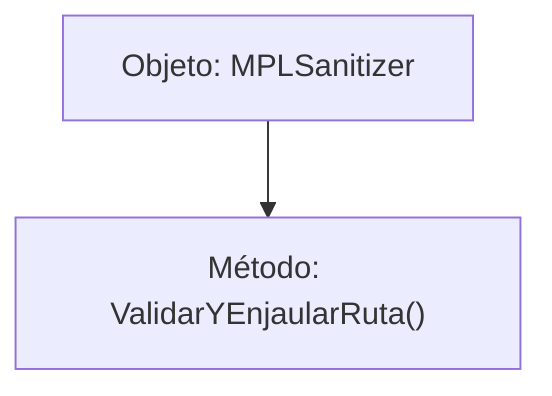

# 📦 Nodo Objeto Conceptual: `MPLSanitizer`

[[Index|⬅️ Índice]] | Fichero Origen: [[fuente_mpl_runtime-code_01_sanitizer_mpl|📄 fuente/mpl_runtime-code/01_sanitizer.mpl]]

## ⚙️ Estado y Propiedades
* **`raiz_contenedor`**: `./`
* **`ruta_candidata`**: ``
* **`ruta_abs_real`**: ``
* **`es_valida`**: `True`
* **`violacion_detectada`**: `False`
* **`caracter_prohibido`**: `False`

## 🛠️ Métodos e Instrucciones Concretas Línea por Línea
### Método `ValidarYEnjaularRuta()`
| N° | Instrucción Concreta | Explicación Semántica | 'man' Ficha |
| :--- | :--- | :--- | :--- |
| `1` | `ESTADO.ruta_candidata = ruta_entrada` | Mutación o llamada interna | Operador de acceso y mutación al estado interno del objeto conceptual activo. Garantiza aislamiento en la gestión del dominio. |
| `2` | `CONTIENE_CADENA(ESTADO.ruta_candidata, "\x00", ESTADO.caracter_prohibido)` | Mutación o llamada interna | Operador de acceso y mutación al estado interno del objeto conceptual activo. Garantiza aislamiento en la gestión del dominio. |
| `3` | `CONTIENE_CADENA(ESTADO.ruta_candidata, "..", ESTADO.violacion_detectada)` | Mutación o llamada interna | Operador de acceso y mutación al estado interno del objeto conceptual activo. Garantiza aislamiento en la gestión del dominio. |
| `4` | `MIENTRAS ESTADO.violacion_detectada HASTA` | Mutación o llamada interna | Operador de acceso y mutación al estado interno del objeto conceptual activo. Garantiza aislamiento en la gestión del dominio. |
| `5` | `MOSTRAR "[Security Violation] Intento de Path Traversal denegado."` | Mutación o llamada interna | Imprime una salida formateada de texto en las consolas o terminales de trazado en tiempo real de los drivers de UI. |
| `6` | `ESTADO.es_valida = Falso` | Mutación o llamada interna | Operador de acceso y mutación al estado interno del objeto conceptual activo. Garantiza aislamiento en la gestión del dominio. |
| `7` | `ESTADO.violacion_detectada = Falso` | Mutación o llamada interna | Operador de acceso y mutación al estado interno del objeto conceptual activo. Garantiza aislamiento en la gestión del dominio. |
| `8` | `FIN_MIENTRAS` | Mutación o llamada interna | Bucle condicional iterativo de bajo nivel para procesamiento de archivos, listas y parsing atómico de estructuras AST. |
| `9` | `ESTADO.ruta_abs_real = ESTADO.ruta_candidata` | Mutación o llamada interna | Operador de acceso y mutación al estado interno del objeto conceptual activo. Garantiza aislamiento en la gestión del dominio. |
| `10` | `MOSTRAR "[Sanitizer] Ruta validada y enjaulada dinámicamente dentro del contenedor."` | Mutación o llamada interna | Imprime una salida formateada de texto en las consolas o terminales de trazado en tiempo real de los drivers de UI. |

## 📊 Diagrama de Estructura Interna (Mermaid)

