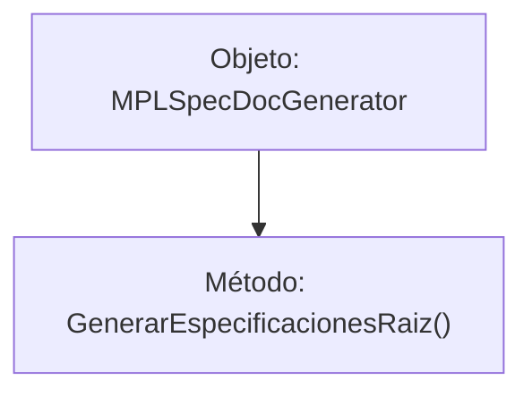

# 📦 Nodo Objeto Conceptual: `MPLSpecDocGenerator`

[[Index|⬅️ Índice]] | Fichero Origen: [[fuente_mpl_runtime-code_02_spec_generator_mpl|📄 fuente/mpl_runtime-code/02_spec_generator.mpl]]

## ⚙️ Estado y Propiedades
* **`index_content`**: ``
* **`c1_content`**: ``
* **`ebnf_content`**: ``
* **`data_content`**: ``
* **`man_content`**: ``
* **`skill_content`**: ``

## 🛠️ Métodos e Instrucciones Concretas Línea por Línea
### Método `GenerarEspecificacionesRaiz()`
| N° | Instrucción Concreta | Explicación Semántica | 'man' Ficha |
| :--- | :--- | :--- | :--- |
| `1` | `ESTADO.index_content = "# 📐 Bóveda de Especificación Oficial de MPL (v0.1.5-alpha / Self-Hosting Ready)\n\nDocumentación de referencia del lenguaje para desarrolladores y mantenimiento del kernel.\n\n## 📚 Secciones de la Especificación\n* [[01_Arquitectura_Capas\|🏛️ 01. Arquitectura en 3 Capas (C1, C2, C3)]]\n* [[02_Gramatica_EBNF\|🔤 02. Gramática EBNF y Sintaxis Ampliada]]\n* [[03_Estructuras_Datos\|🥞 03. Estructuras de Datos Nativas (PILA & E/S Kernel)]]\n* [[04_Manual_Instrucciones\|📖 04. Manual Completo de Instrucciones ('man')]]\n* [[05_Modelo_Fachada\|🏰 05. Modelo de Importación Fachada e Importación en Racimo]]\n* [[06_Seguridad_y_Sanitizacion\|🛡️ 06. Modelo de Seguridad, Enjaulamiento y Sanitización]]"` | Mutación o llamada interna | Operador de acceso y mutación al estado interno del objeto conceptual activo. Garantiza aislamiento en la gestión del dominio. |
| `2` | `ESCRIBIR_ARCHIVO("mpl-spec-vault/Index.md", ESTADO.index_content)` | Mutación o llamada interna | Operador de acceso y mutación al estado interno del objeto conceptual activo. Garantiza aislamiento en la gestión del dominio. |
| `3` | `ESTADO.c1_content = "# 🏛️ Arquitectura de MPL en 3 Capas\n\n[[Index\|⬅️ Volver al Índice]]\n\nMPL organiza el software desacoplando la interfaz, el estado y el algoritmo imperativo:\n\n* **Capa 3 (Interfaz & Vistas - `PANTALLA`):** Define el árbol de navegación visual y mapea opciones con acciones.\n* **Capa 2 (Dominio & Estado - `OBJETO_CONCEPTUAL`):** Modela la lógica del problema, propiedades mutables (`ESTADO.*`) y métodos.\n* **Capa 1 (Imperativa Estricta - `FUNCION`):** Funciones puras de bajo nivel para procesamiento y transformaciones sintácticas."` | Mutación o llamada interna | Declara una vista o componente de la interfaz de usuario. Contiene un encabezado visual y un conjunto de opciones o eventos interactivos. |
| `4` | `ESCRIBIR_ARCHIVO("mpl-spec-vault/01_Arquitectura_Capas.md", ESTADO.c1_content)` | Mutación o llamada interna | Operador de acceso y mutación al estado interno del objeto conceptual activo. Garantiza aislamiento en la gestión del dominio. |
| `5` | `ESTADO.ebnf_content = "# 🔤 Gramática Formal EBNF de MPL\n\n[[Index\|⬅️ Volver al Índice]]\n\n```ebnf\nPrograma        ::= ( Importacion \| Pantalla \| ObjetoConcept \| Funcion )*\nImportacion     ::= \"IMPORTAR\" \"\\\"\" RutaRelativa \"\\\"\"\nPantalla        ::= \"PANTALLA\" Cadena \":\" Encabezado Opcion*\nEncabezado      ::= \"ENCABEZADO:\" \"\\\"\" Texto \"\\\"\"\nOpcion          ::= \"OPCION\" \"\\\"\" Texto \"\\\"\" \"CON_ACCION\" Accion\nAccion          ::= \"TRANSICIONAR_A\" Identificador \| Identificador\nObjetoConcept   ::= \"OBJETO_CONCEPTUAL\" Identificador \":\" Propiedades Interacciones\nPropiedades     ::= \"PROPIEDADES:\" ( Identificador \":\" ( ValorPrimitivo \| \"PILA\" ) )*\nInteracciones   ::= \"INTERACCIONES:\" Metodo*\nMetodo          ::= \"METODO\" Identificador \"():\" Sentencia*\nFuncion         ::= \"FUNCION\" Identificador \"(\" Parametros \"):\" Sentencia* \"FIN_FUNCION\"\n```"` | Mutación o llamada interna | Carga dinámicamente un módulo MPL. Exige que el fichero resida en la subcarpeta acotada <facade>-code/, ./fuente/ o ./ejemplos/ y resuelve sus dependencias de forma recursiva. |
| `6` | `ESCRIBIR_ARCHIVO("mpl-spec-vault/02_Gramatica_EBNF.md", ESTADO.ebnf_content)` | Mutación o llamada interna | Operador de acceso y mutación al estado interno del objeto conceptual activo. Garantiza aislamiento en la gestión del dominio. |
| `7` | `ESTADO.data_content = "# 🥞 Estructuras de Datos Nativas\n\n[[Index\|⬅️ Volver al Índice]]\n\n## La Estructura PILA (LIFO)\nMPL incluye una implementación nativa de PILA integrada en la Capa 2:\n* **Declaración:** `<propiedad>: PILA` dentro de `PROPIEDADES:`\n* **Apilar / Push:** `ESTADO.<pila>.APILAR(<valor>)` o `ESTADO.<pila>.PUSH(<valor>)`\n* **Desapilar / Pop:** `ESTADO.<pila>.DESAPILAR()`\n\n## Primitivas I/O del Kernel v0.1.5\n* `LEER_ARCHIVO(ruta, destino)`: Carga el contenido de un fichero enjaulado.\n* `ESCRIBIR_ARCHIVO(ruta, contenido)`: Guarda texto en el espacio de trabajo.\n* `DIVIDIR_CADENA(texto, delim, pila_dest)`: Tokeniza y apila segmentos."` | Mutación o llamada interna | Sección contenedora de variables de estado del objeto. Soporta tipos primitivos (Enteros, Booleans, Cadenas) y la estructura de datos PILA. |
| `8` | `ESCRIBIR_ARCHIVO("mpl-spec-vault/03_Estructuras_Datos.md", ESTADO.data_content)` | Mutación o llamada interna | Operador de acceso y mutación al estado interno del objeto conceptual activo. Garantiza aislamiento en la gestión del dominio. |
| `9` | `ESTADO.man_content = "# 📖 Manual Completo de Instrucciones ('man')\n\n[[Index\|⬅️ Volver al Índice]]\n\n\| Instrucción \| Capa \| Sintaxis \| Descripción \|\n\| :--- \| :--- \| :--- \| :--- \|\n\| `IMPORTAR` \| Sistema \| `IMPORTAR \"fichero.mpl\"` \| Carga dinámicamente un módulo MPL desde <facade>-code/. \|\n\| `PANTALLA` \| Capa 3 \| `PANTALLA <Nombre>:` \| Declara una vista o interfaz de usuario. \|\n\| `ENCABEZADO:` \| Capa 3 \| `ENCABEZADO: \"Texto\"` \| Establece el título visual de la pantalla. \|\n\| `OPCION` \| Capa 3 \| `OPCION \"Texto\" CON_ACCION <Accion>` \| Mapea un botón o entrada interactiva. \|\n\| `TRANSICIONAR_A` \| Capa 3 \| `TRANSICIONAR_A <Pantalla>` \| Cambia la vista activa en tiempo de ejecución. \|\n\| `OBJETO_CONCEPTUAL` \| Capa 2 \| `OBJETO_CONCEPTUAL <Nombre>:` \| Define una entidad conceptual con estado. \|\n\| `LEER_ARCHIVO` \| Kernel \| `LEER_ARCHIVO(\"ruta\", dest)` \| Lee un archivo enjaulado en el espacio de trabajo. \|\n\| `ESCRIBIR_ARCHIVO` \| Kernel \| `ESCRIBIR_ARCHIVO(\"ruta\", txt)` \| Guarda o sobrescribe texto en disco. \|\n\| `DIVIDIR_CADENA` \| Kernel \| `DIVIDIR_CADENA(txt, delim, pila)` \| Tokeniza cadenas y apila sus elementos. \|\n\| `CONTIENE_CADENA` \| Kernel \| `CONTIENE_CADENA(txt, sub, res)` \| Evalúa la presencia de subcadenas. \|\n\| `REEMPLAZAR_TEXTO` \| Kernel \| `REEMPLAZAR_TEXTO(txt, v, n, dest)` \| Sustituye patrones de texto en variables. \|"` | Mutación o llamada interna | Carga dinámicamente un módulo MPL. Exige que el fichero resida en la subcarpeta acotada <facade>-code/, ./fuente/ o ./ejemplos/ y resuelve sus dependencias de forma recursiva. |
| `10` | `ESCRIBIR_ARCHIVO("mpl-spec-vault/04_Manual_Instrucciones.md", ESTADO.man_content)` | Mutación o llamada interna | Operador de acceso y mutación al estado interno del objeto conceptual activo. Garantiza aislamiento en la gestión del dominio. |
| `11` | `ESTADO.skill_content = "# 🤖 AI Agent Skill & Spec Context: Metsu Programming Language (MPL)\n\n> **ROL Y RESTRICCIÓN PARA LA IA:**\n> Eres un programador experto en Metsu Programming Language (MPL). Tu ÚNICO objetivo es generar código MPL sintácticamente correcto. Tienes **ESTRICTAMENTE PROHIBIDO** usar palabras clave, comandos o estructuras sintácticas ajenas a las definidas en este documento.\n\n## 1. REGLAS DE ORO DE SINTAXIS\n1. **Capa 3 (Pantallas):** Toda pantalla inicia con `PANTALLA <Nombre>:`, seguida de `ENCABEZADO: \"...\"` y opciones `OPCION \"<Texto>\" CON_ACCION <Accion>`.\n2. **Transiciones:** Para cambiar de pantalla se usa ÚNICAMENTE `TRANSICIONAR_A <PantallaDestino>`.\n3. **Capa 2 (Objetos Conceptuales):** Inicia con `OBJETO_CONCEPTUAL <Nombre>:`, sección `PROPIEDADES:` e `INTERACCIONES:`.\n4. **Mutación de Estado:** Para modificar una variable de un objeto dentro de sus métodos se usa OBLIGATORIAMENTE `ESTADO.<propiedad> = <valor>`.\n5. **Estructura PILA:** Se declara `<nombre>: PILA` y se manipula con `ESTADO.<pila>.APILAR(<valor>)`.\n6. **Capa 1 (Funciones):** Se declara `FUNCION <nombre>(<params>):`, las líneas de salida usan `Imprimir(\"...\")` o `MOSTRAR \"...\"` y termina obligatoriamente en `FIN_FUNCION`.\n7. **Importaciones:** Solo se usa `IMPORTAR \"<fichero_relativo>.mpl\"`. Las rutas deben apuntar a ficheros dentro de `<facade>-code/`."` | Mutación o llamada interna | Carga dinámicamente un módulo MPL. Exige que el fichero resida en la subcarpeta acotada <facade>-code/, ./fuente/ o ./ejemplos/ y resuelve sus dependencias de forma recursiva. |
| `12` | `ESCRIBIR_ARCHIVO("mpl_spec_skill.md", ESTADO.skill_content)` | Mutación o llamada interna | Operador de acceso y mutación al estado interno del objeto conceptual activo. Garantiza aislamiento en la gestión del dominio. |
| `13` | `MOSTRAR "[Spec Generator] Bóveda de Especificación Oficial y Skill IA autogeneradas dinámicamente."` | Mutación o llamada interna | Imprime una salida formateada de texto en las consolas o terminales de trazado en tiempo real de los drivers de UI. |

## 📊 Diagrama de Estructura Interna (Mermaid)


