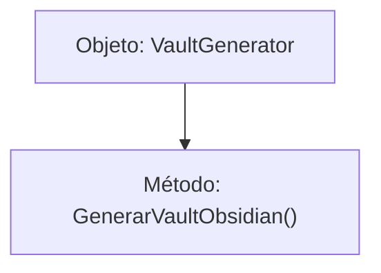

# 📦 Nodo Objeto Conceptual: `VaultGenerator`

[[Index|⬅️ Índice]] | Fichero Origen: [[fuente_mpl_runtime-code_05_asset_manager_mpl|📄 fuente/mpl_runtime-code/05_asset_manager.mpl]]

## ⚙️ Estado y Propiedades
* **`ruta_facade_objetivo`**: ``
* **`ruta_dir_vault`**: ``
* **`ruta_index_md`**: ``
* **`ruta_seguridad_md`**: ``
* **`buffer_index`**: ``
* **`buffer_seguridad`**: ``

## 🛠️ Métodos e Instrucciones Concretas Línea por Línea
### Método `GenerarVaultObsidian()`
| N° | Instrucción Concreta | Explicación Semántica | 'man' Ficha |
| :--- | :--- | :--- | :--- |
| `1` | `ESTADO.ruta_facade_objetivo = ruta_fichero` | Mutación o llamada interna | Operador de acceso y mutación al estado interno del objeto conceptual activo. Garantiza aislamiento en la gestión del dominio. |
| `2` | `REEMPLAZAR_TEXTO(ruta_fichero, ".mpl", "-vault/Index.md", ruta_index_md)` | Mutación o llamada interna | Sustituye todas las apariciones de una subcadena por una nueva en el texto especificado y asigna el resultado a var_destino. |
| `3` | `REEMPLAZAR_TEXTO(ruta_fichero, ".mpl", "-vault/Seguridad_y_Enjaulamiento.md", ruta_seguridad_md)` | Mutación o llamada interna | Sustituye todas las apariciones de una subcadena por una nueva en el texto especificado y asigna el resultado a var_destino. |
| `4` | `ESTADO.buffer_index = "# 🗺️ Arquitectura e Índice de Bóveda Atómica\n\nDesglose dinámico línea por línea del proyecto.\n\n🛡️ [[Seguridad_y_Enjaulamiento\|Ver Informe de Seguridad]]\n\n## 📁 Ficheros del Proyecto\nDesglose atómico de módulos cargados dinámicamente.\n\n## 📊 Diagrama Topológico General (Mermaid)\n```mermaid\ngraph TD\n    facade[\"Fachada Principal\"]\n```"` | Mutación o llamada interna | Operador de acceso y mutación al estado interno del objeto conceptual activo. Garantiza aislamiento en la gestión del dominio. |
| `5` | `ESCRIBIR_ARCHIVO(ESTADO.ruta_index_md, ESTADO.buffer_index)` | Mutación o llamada interna | Operador de acceso y mutación al estado interno del objeto conceptual activo. Garantiza aislamiento en la gestión del dominio. |
| `6` | `ESTADO.buffer_seguridad = "# 🛡️ Informe de Seguridad y Enjaulamiento\n\n## 🔒 Políticas de Seguridad Aplicadas en Runtime (v0.1.5-alpha)\n1. **Enjaulamiento Sandbox:** Acceso restringido dinámicamente a la raíz y subcarpetas permitidas.\n2. **Path Traversal Protection:** Denegación de saltos fuera del directorio contenedor mediante `realpath`.\n3. **Sanitización CLI:** Depuración de bytes nulos (`\\x00`) y truncado defensivo a 4096 caracteres."` | Mutación o llamada interna | Operador de acceso y mutación al estado interno del objeto conceptual activo. Garantiza aislamiento en la gestión del dominio. |
| `7` | `ESCRIBIR_ARCHIVO(ESTADO.ruta_seguridad_md, ESTADO.buffer_seguridad)` | Mutación o llamada interna | Operador de acceso y mutación al estado interno del objeto conceptual activo. Garantiza aislamiento en la gestión del dominio. |
| `8` | `MOSTRAR "[Vault Generator] Bóveda Obsidian ATÓMICA generada dinámicamente para el proyecto activo."` | Mutación o llamada interna | Imprime una salida formateada de texto en las consolas o terminales de trazado en tiempo real de los drivers de UI. |

## 📊 Diagrama de Estructura Interna (Mermaid)


