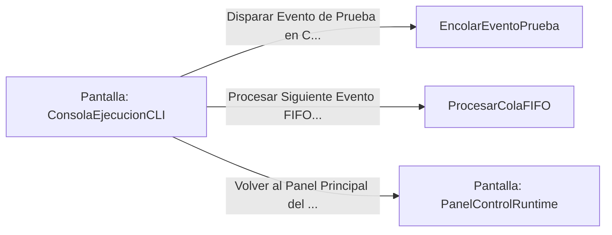

# 📺 Nodo Pantalla: `ConsolaEjecucionCLI`

[[Index|⬅️ Índice]] | Fichero Origen: [[fuente_mpl_runtime_mpl|📄 fuente/mpl_runtime.mpl]]

**Narrativa y Encabezado:**
> --- TERMINAL & EVENT LOOP FIFO (METSUOS LOG NATIVO) ---
> Monitorización en tiempo real de eventos, mutaciones de estado y ejecuciones C1/C2.

## 📋 Desglose de Instrucciones de Opciones
### `OPCION "Disparar Evento de Prueba en Cola FIFO" CON_ACCION EncolarEventoPrueba`
* **Instrucción:** `OPCION` *(Manual: Mapea una entrada o botón interactivo de usuario. Vincular una acción como la invocación de una función C1, un método C2 o una transición C3.)*
* **Efecto de Control:** Ejecuta el método/acción `EncolarEventoPrueba`
### `OPCION "Procesar Siguiente Evento FIFO en Cola" CON_ACCION ProcesarColaFIFO`
* **Instrucción:** `OPCION` *(Manual: Mapea una entrada o botón interactivo de usuario. Vincular una acción como la invocación de una función C1, un método C2 o una transición C3.)*
* **Efecto de Control:** Ejecuta el método/acción `ProcesarColaFIFO`
### `OPCION "Volver al Panel Principal del Kernel" CON_ACCION TRANSICIONAR_A PanelControlRuntime`
* **Instrucción:** `OPCION` *(Manual: Mapea una entrada o botón interactivo de usuario. Vincular una acción como la invocación de una función C1, un método C2 o una transición C3.)*
* **Efecto de Control:** Dispara `TRANSICIONAR_A` hacia [[Pantalla_PanelControlRuntime|📺 PanelControlRuntime]]

## 📊 Diagrama de Flujo e Interacción (Mermaid)

