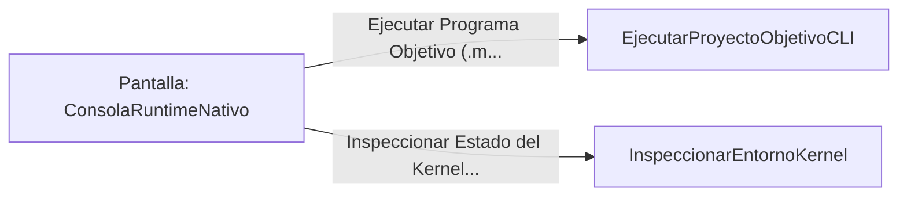

# 📺 Nodo Pantalla: `ConsolaRuntimeNativo`

[[Index|⬅️ Índice]] | Fichero Origen: [[fuente_mpl_runtime_mpl|📄 fuente/mpl_runtime.mpl]]

**Narrativa y Encabezado:**
> ************************************************************
> *  [MPL SELF-HOSTED RUNTIME v0.1.5] - ENTORNO NATIVO .MPL  *
> ************************************************************
> 
> Ejecutando directamente en driver CLI estándar (sin compilación).
> El kernel ha capturado el argumento de entrada para procesar el proyecto objetivo.

## 📋 Desglose de Instrucciones de Opciones
### `OPCION "Ejecutar Programa Objetivo (.mpl pasado por argumento)" CON_ACCION EjecutarProyectoObjetivoCLI`
* **Instrucción:** `OPCION` *(Manual: Mapea una entrada o botón interactivo de usuario. Vincular una acción como la invocación de una función C1, un método C2 o una transición C3.)*
* **Efecto de Control:** Ejecuta el método/acción `EjecutarProyectoObjetivoCLI`
### `OPCION "Inspeccionar Estado del Kernel y Argumentos Inyectados" CON_ACCION InspeccionarEntornoKernel`
* **Instrucción:** `OPCION` *(Manual: Mapea una entrada o botón interactivo de usuario. Vincular una acción como la invocación de una función C1, un método C2 o una transición C3.)*
* **Efecto de Control:** Ejecuta el método/acción `InspeccionarEntornoKernel`

## 📊 Diagrama de Flujo e Interacción (Mermaid)

