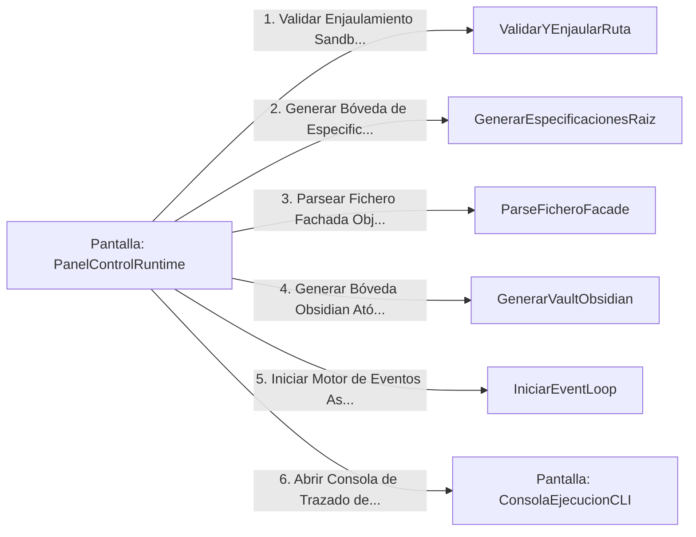

# 📺 Nodo Pantalla: `PanelControlRuntime`

[[Index|⬅️ Índice]] | Fichero Origen: [[fuente_mpl_runtime_mpl|📄 fuente/mpl_runtime.mpl]]

**Narrativa y Encabezado:**
> === METSU PROGRAMMING LANGUAGE (MPL) - RUNTIME KERNEL NATIVO ===
> Entorno Autónomo de Ejecución, Parsing AST y Self-Hosting Integrado
> 
> Sistema dinámico acotado a la subcarpeta mpl_runtime-code/. Seleccione una operación para ejecutar sobre el proyecto activo.

## 📋 Desglose de Instrucciones de Opciones
### `OPCION "1. Validar Enjaulamiento Sandbox y Sanitizar Ruta" CON_ACCION ValidarYEnjaularRuta`
* **Instrucción:** `OPCION` *(Manual: Mapea una entrada o botón interactivo de usuario. Vincular una acción como la invocación de una función C1, un método C2 o una transición C3.)*
* **Efecto de Control:** Ejecuta el método/acción `ValidarYEnjaularRuta`
### `OPCION "2. Generar Bóveda de Especificación Oficial y Skill IA" CON_ACCION GenerarEspecificacionesRaiz`
* **Instrucción:** `OPCION` *(Manual: Mapea una entrada o botón interactivo de usuario. Vincular una acción como la invocación de una función C1, un método C2 o una transición C3.)*
* **Efecto de Control:** Ejecuta el método/acción `GenerarEspecificacionesRaiz`
### `OPCION "3. Parsear Fichero Fachada Objetivo y Generar Grafo AST" CON_ACCION ParseFicheroFacade`
* **Instrucción:** `OPCION` *(Manual: Mapea una entrada o botón interactivo de usuario. Vincular una acción como la invocación de una función C1, un método C2 o una transición C3.)*
* **Efecto de Control:** Ejecuta el método/acción `ParseFicheroFacade`
### `OPCION "4. Generar Bóveda Obsidian Atómica Línea a Línea" CON_ACCION GenerarVaultObsidian`
* **Instrucción:** `OPCION` *(Manual: Mapea una entrada o botón interactivo de usuario. Vincular una acción como la invocación de una función C1, un método C2 o una transición C3.)*
* **Efecto de Control:** Ejecuta el método/acción `GenerarVaultObsidian`
### `OPCION "5. Iniciar Motor de Eventos Asíncrono (Event Loop FIFO)" CON_ACCION IniciarEventLoop`
* **Instrucción:** `OPCION` *(Manual: Mapea una entrada o botón interactivo de usuario. Vincular una acción como la invocación de una función C1, un método C2 o una transición C3.)*
* **Efecto de Control:** Ejecuta el método/acción `IniciarEventLoop`
### `OPCION "6. Abrir Consola de Trazado de Eventos (CLI)" CON_ACCION TRANSICIONAR_A ConsolaEjecucionCLI`
* **Instrucción:** `OPCION` *(Manual: Mapea una entrada o botón interactivo de usuario. Vincular una acción como la invocación de una función C1, un método C2 o una transición C3.)*
* **Efecto de Control:** Dispara `TRANSICIONAR_A` hacia [[Pantalla_ConsolaEjecucionCLI|📺 ConsolaEjecucionCLI]]

## 📊 Diagrama de Flujo e Interacción (Mermaid)

