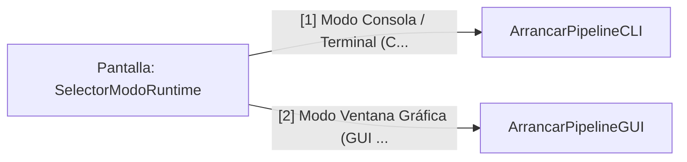

# 📺 Nodo Pantalla: `SelectorModoRuntime`

[[Index|⬅️ Índice]] | Fichero Origen: [[fuente_mpl_runtime_mpl|📄 fuente/mpl_runtime.mpl]]

**Narrativa y Encabezado:**
> ============================================================
>       METSU PROGRAMMING LANGUAGE (MPL) - RUNTIME KERNEL
> ============================================================
> 
> Seleccione el modo de renderizado UI para iniciar la ejecución:

## 📋 Desglose de Instrucciones de Opciones
### `OPCION "[1] Modo Consola / Terminal (CLI)" CON_ACCION ArrancarPipelineCLI`
* **Instrucción:** `OPCION` *(Manual: Mapea una entrada o botón interactivo de usuario. Vincular una acción como la invocación de una función C1, un método C2 o una transición C3.)*
* **Efecto de Control:** Ejecuta el método/acción `ArrancarPipelineCLI`
### `OPCION "[2] Modo Ventana Gráfica (GUI Dark Mode WCAG AAA)" CON_ACCION ArrancarPipelineGUI`
* **Instrucción:** `OPCION` *(Manual: Mapea una entrada o botón interactivo de usuario. Vincular una acción como la invocación de una función C1, un método C2 o una transición C3.)*
* **Efecto de Control:** Ejecuta el método/acción `ArrancarPipelineGUI`

## 📊 Diagrama de Flujo e Interacción (Mermaid)

