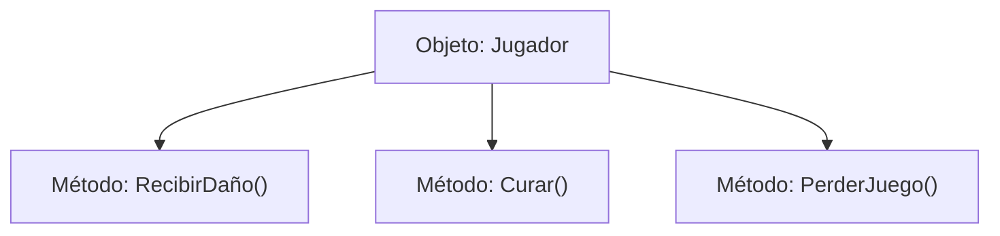

# 📦 Nodo Objeto Conceptual: `Jugador`

[[Index|⬅️ Índice]] | Fichero Origen: [[sample_eligejuego_mpl|📄 sample/eligejuego.mpl]]

## ⚙️ Estado y Propiedades
* **`salud`**: `100`
* **`llaves_obtenidas`**: `0`
* **`inventario`**: `PILA`
* **`modulo_cronal_activo`**: `True`

## 🛠️ Métodos e Instrucciones Concretas Línea por Línea
### Método `RecibirDaño()`
| N° | Instrucción Concreta | Explicación Semántica | 'man' Ficha |
| :--- | :--- | :--- | :--- |
### Método `Curar()`
| N° | Instrucción Concreta | Explicación Semántica | 'man' Ficha |
| :--- | :--- | :--- | :--- |
### Método `PerderJuego()`
| N° | Instrucción Concreta | Explicación Semántica | 'man' Ficha |
| :--- | :--- | :--- | :--- |

## 📊 Diagrama de Estructura Interna (Mermaid)

