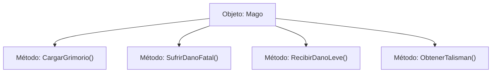

# 📦 Nodo Objeto Conceptual: `Mago`

[[Index|⬅️ Índice]] | Fichero Origen: [[sample_eligejuego-code_capa2_mago_mpl|📄 sample/eligejuego-code/capa2_mago.mpl]]

## ⚙️ Estado y Propiedades
* **`vida`**: `20`
* **`mana`**: `15`
* **`tiene_talisman`**: `False`
* **`equipo`**: `PILA`

## 🛠️ Métodos e Instrucciones Concretas Línea por Línea
### Método `CargarGrimorio()`
| N° | Instrucción Concreta | Explicación Semántica | 'man' Ficha |
| :--- | :--- | :--- | :--- |
### Método `SufrirDanoFatal()`
| N° | Instrucción Concreta | Explicación Semántica | 'man' Ficha |
| :--- | :--- | :--- | :--- |
### Método `RecibirDanoLeve()`
| N° | Instrucción Concreta | Explicación Semántica | 'man' Ficha |
| :--- | :--- | :--- | :--- |
### Método `ObtenerTalisman()`
| N° | Instrucción Concreta | Explicación Semántica | 'man' Ficha |
| :--- | :--- | :--- | :--- |

## 📊 Diagrama de Estructura Interna (Mermaid)

