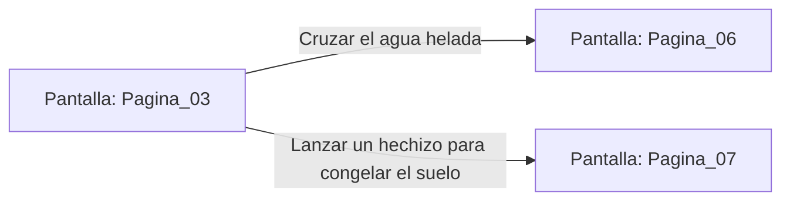

# 📺 Nodo Pantalla: `Pagina_03`

[[Index|⬅️ Índice]] | Fichero Origen: [[sample_eligejuego-code_capa3_vistas_1_mpl|📄 sample/eligejuego-code/capa3_vistas_1.mpl]]

**Encabezado Visual:** "Página 3: El Pasaje Inundado"

## 📋 Desglose de Instrucciones de Opciones
### `OPCION "Cruzar el agua helada" CON_ACCION TRANSICIONAR_A Pagina_06`
* **Instrucción:** `OPCION` *(Manual: Mapea una entrada o botón interactivo de usuario. Vincular una acción como la invocación de una función C1, un método C2 o una transición C3.)*
* **Efecto de Control:** Dispara `TRANSICIONAR_A` hacia [[Pantalla_Pagina_06|📺 Pagina_06]] *(Manual: Primitiva de control de flujo UI. Emite un evento asíncrono al Event Loop para cambiar la vista activa a la pantalla de destino.)*
### `OPCION "Lanzar un hechizo para congelar el suelo" CON_ACCION TRANSICIONAR_A Pagina_07`
* **Instrucción:** `OPCION` *(Manual: Mapea una entrada o botón interactivo de usuario. Vincular una acción como la invocación de una función C1, un método C2 o una transición C3.)*
* **Efecto de Control:** Dispara `TRANSICIONAR_A` hacia [[Pantalla_Pagina_07|📺 Pagina_07]] *(Manual: Primitiva de control de flujo UI. Emite un evento asíncrono al Event Loop para cambiar la vista activa a la pantalla de destino.)*

## 📊 Diagrama de Flujo e Interacción (Mermaid)

