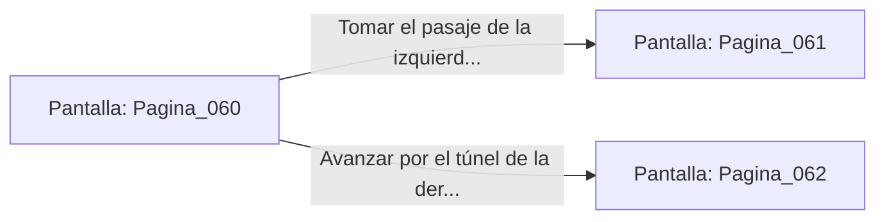

# 📺 Nodo Pantalla: `Pagina_060`

[[Index|⬅️ Índice]] | Fichero Origen: [[sample_eligejuego-code_capitulo_01_entradas_mpl|📄 sample/eligejuego-code/capitulo_01_entradas.mpl]]

**Narrativa y Encabezado:**
> Página 60: El Umbral y las Entradas
> 
> Avanzas por los muros de piedra musgosa. Las antorchas chisporrotean y una brisa fría trae un olor a azufre y sangre vieja. Te encuentras ante una encrucijada en la penumbra de la mazmorra. Debes tomar una decisión.

## 📋 Desglose de Instrucciones de Opciones
### `OPCION "Tomar el pasaje de la izquierda (Página 61)" CON_ACCION TRANSICIONAR_A Pagina_061`
* **Instrucción:** `OPCION` *(Manual: Mapea una entrada o botón interactivo de usuario. Vincular una acción como la invocación de una función C1, un método C2 o una transición C3.)*
* **Efecto de Control:** Dispara `TRANSICIONAR_A` hacia [[Pantalla_Pagina_061|📺 Pagina_061]]
### `OPCION "Avanzar por el túnel de la derecha (Página 62)" CON_ACCION TRANSICIONAR_A Pagina_062`
* **Instrucción:** `OPCION` *(Manual: Mapea una entrada o botón interactivo de usuario. Vincular una acción como la invocación de una función C1, un método C2 o una transición C3.)*
* **Efecto de Control:** Dispara `TRANSICIONAR_A` hacia [[Pantalla_Pagina_062|📺 Pagina_062]]

## 📊 Diagrama de Flujo e Interacción (Mermaid)

