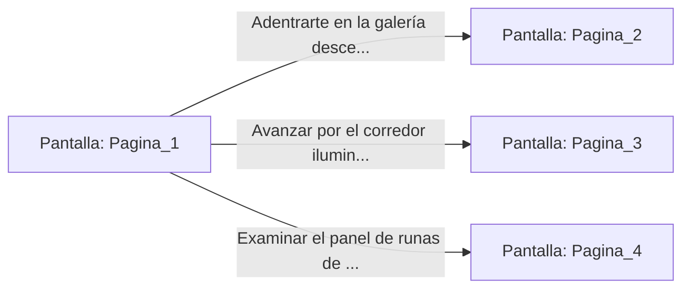

# 📺 Nodo Pantalla: `Pagina_1`

[[Index|⬅️ Índice]] | Fichero Origen: [[sample_eligejuego_mpl|📄 sample/eligejuego.mpl]]

**Narrativa y Encabezado:**
> PÁGINA 1: EL DESPERTAR EN EL NÚCLEO CRONAL
> 
> El frío del metal ancestral se clava en tus huesos antes incluso de que logres abrir los ojos. A tu alrededor, las ruinas de la Ciudadela Subterránea de Aethelgard laten con un zumbido violeta, vestigio de una tecnología olvidada que apenas comprendes. Tus recuerdos están fragmentados en astillas de fuego y ceniza, pero una única certeza quema en tu mente: el Cronoclave de las Sombras ha sido activado y la realidad misma se está deshilachando por las costuras.
> 
> Frente a ti se proyecta el holograma tenue de la Archivista Vaelia. Su figura parpadea con interferencias de flujo temporal mientras pronuncia tus objetivos antes de desvanecerse: debes penetrar las profundidades de las 600 Cámaras, recuperar los fragmentos del Núcleo de Éter y neutralizar al Inquisidor Malakor antes de que el Colapso de Mnemósine devore todas las líneas temporales existentes. En tu muñeca, el Brazal de Convergencia brilla con tenacidad; en tu bolsillo, la primera Decisionario de Éter espera tu elección.
> 
> El aire huele a ozono y a piedra quemada. Ante ti se abren tres pasadizos esculpidos en la roca basáltica: una galería descendente envuelta en brumas verdosas, un corredor iluminado por antorchas de fuego alquímico y una escotilla neumática bloqueada por un panel de runas parpadeantes.

## 📋 Desglose de Instrucciones de Opciones
### `OPCION "Adentrarte en la galería descendente rodeada de brumas verdosas" CON_ACCION TRANSICIONAR_A Pagina_2`
* **Instrucción:** `OPCION` *(Manual: Mapea una entrada o botón interactivo de usuario. Vincular una acción como la invocación de una función C1, un método C2 o una transición C3.)*
* **Efecto de Control:** Dispara `TRANSICIONAR_A` hacia [[Pantalla_Pagina_2|📺 Pagina_2]]
### `OPCION "Avanzar por el corredor iluminado por fuego alquímico" CON_ACCION TRANSICIONAR_A Pagina_3`
* **Instrucción:** `OPCION` *(Manual: Mapea una entrada o botón interactivo de usuario. Vincular una acción como la invocación de una función C1, un método C2 o una transición C3.)*
* **Efecto de Control:** Dispara `TRANSICIONAR_A` hacia [[Pantalla_Pagina_3|📺 Pagina_3]]
### `OPCION "Examinar el panel de runas de la escotilla neumática" CON_ACCION TRANSICIONAR_A Pagina_4`
* **Instrucción:** `OPCION` *(Manual: Mapea una entrada o botón interactivo de usuario. Vincular una acción como la invocación de una función C1, un método C2 o una transición C3.)*
* **Efecto de Control:** Dispara `TRANSICIONAR_A` hacia [[Pantalla_Pagina_4|📺 Pagina_4]]

## 📊 Diagrama de Flujo e Interacción (Mermaid)

