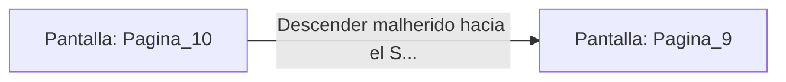

# 📺 Nodo Pantalla: `Pagina_10`

[[Index|⬅️ Índice]] | Fichero Origen: [[sample_eligejuego-code_capitulo_01_mpl|📄 sample/eligejuego-code/capitulo_01.mpl]]

**Narrativa y Encabezado:**
> PÁGINA 10: LA DESCARGA RÚNICA
> 
> Te inclinas para examinar los filamentos de cristal que alimentan el panel de runas. Al manipularlos con imprudencia, una chispa de energía arcana salta directamente a tu pecho, infligiéndote un choque eléctrico que te arroja varios metros hacia atrás.
> 
> Soportando el dolor y con la piel marcada por la descarga, te incorporas torpemente. El panel ha quedado completamente calcinado, no dejándote más opción que descender por la escotilla neumática.

## 📋 Desglose de Instrucciones de Opciones
### `OPCION "Descender malherido hacia el Sector Inferior" CON_ACCION TRANSICIONAR_A Pagina_9`
* **Instrucción:** `OPCION` *(Manual: Mapea una entrada o botón interactivo de usuario. Vincular una acción como la invocación de una función C1, un método C2 o una transición C3.)*
* **Efecto de Control:** Dispara `TRANSICIONAR_A` hacia [[Pantalla_Pagina_9|📺 Pagina_9]]

## 📊 Diagrama de Flujo e Interacción (Mermaid)

