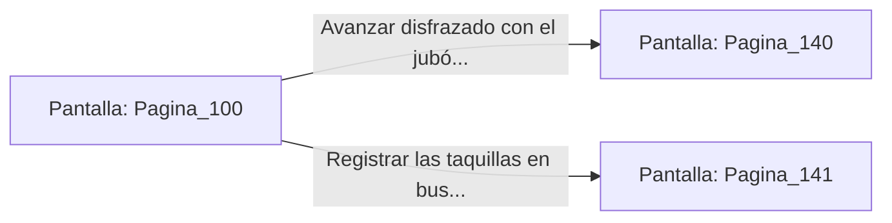

# 📺 Nodo Pantalla: `Pagina_100`

[[Index|⬅️ Índice]] | Fichero Origen: [[sample_eligejuego-code_capitulo_06_mpl|📄 sample/eligejuego-code/capitulo_06.mpl]]

**Narrativa y Encabezado:**
> PÁGINA 100: LOS APOSENTOS DE LA GUARDIA
> 
> Sales del aljibe secándote el agua y accedes a los vestuarios de la Guardia Real. Varias armaduras de repuesto cuelgan de los armarios de teca.
> 
> Decides enfundarte un jubón militar con las insignias del regimiento para pasar desapercibido entre los patrulleros del palacio.

## 📋 Desglose de Instrucciones de Opciones
### `OPCION "Avanzar disfrazado con el jubón militar por los pasillos principales" CON_ACCION TRANSICIONAR_A Pagina_140`
* **Instrucción:** `OPCION` *(Manual: Mapea una entrada o botón interactivo de usuario. Vincular una acción como la invocación de una función C1, un método C2 o una transición C3.)*
* **Efecto de Control:** Dispara `TRANSICIONAR_A` hacia [[Pantalla_Pagina_140|📺 Pagina_140]]
### `OPCION "Registrar las taquillas en busca de llaves de pase" CON_ACCION TRANSICIONAR_A Pagina_141`
* **Instrucción:** `OPCION` *(Manual: Mapea una entrada o botón interactivo de usuario. Vincular una acción como la invocación de una función C1, un método C2 o una transición C3.)*
* **Efecto de Control:** Dispara `TRANSICIONAR_A` hacia [[Pantalla_Pagina_141|📺 Pagina_141]]

## 📊 Diagrama de Flujo e Interacción (Mermaid)

