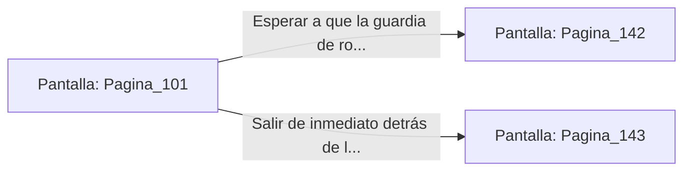

# 📺 Nodo Pantalla: `Pagina_101`

[[Index|⬅️ Índice]] | Fichero Origen: [[sample_eligejuego-code_capitulo_06_mpl|📄 sample/eligejuego-code/capitulo_06.mpl]]

**Narrativa y Encabezado:**
> PÁGINA 101: CONDUCCIONES DE AIRE DEL ALJIBE
> 
> Te adentras por las tuberías secas de ventilación que comunican el aljibe con la red hidráulica superior. El metal está cubierto por una fina capa de salitre que resuena bajo la suela de tus botas.
> 
> Tras diez minutos de ascenso constante, encuentras una salida que desemboca justo detrás de la gran estatua del Fundador en el Gran Comedor.
> 
> Observas la estancia a través de las hendiduras del pedestal de piedra antes de decidir si salir abiertamente o esperar a que la guardia de ronda abandone la sala.

## 📋 Desglose de Instrucciones de Opciones
### `OPCION "Esperar a que la guardia de ronda abandone el Gran Comedor" CON_ACCION TRANSICIONAR_A Pagina_142`
* **Instrucción:** `OPCION` *(Manual: Mapea una entrada o botón interactivo de usuario. Vincular una acción como la invocación de una función C1, un método C2 o una transición C3.)*
* **Efecto de Control:** Dispara `TRANSICIONAR_A` hacia [[Pantalla_Pagina_142|📺 Pagina_142]]
### `OPCION "Salir de inmediato detrás de la estatua y avanzar al vestíbulo" CON_ACCION TRANSICIONAR_A Pagina_143`
* **Instrucción:** `OPCION` *(Manual: Mapea una entrada o botón interactivo de usuario. Vincular una acción como la invocación de una función C1, un método C2 o una transición C3.)*
* **Efecto de Control:** Dispara `TRANSICIONAR_A` hacia [[Pantalla_Pagina_143|📺 Pagina_143]]

## 📊 Diagrama de Flujo e Interacción (Mermaid)

