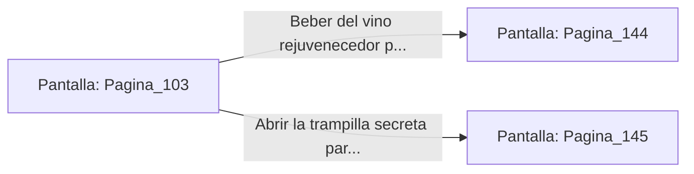

# 📺 Nodo Pantalla: `Pagina_103`

[[Index|⬅️ Índice]] | Fichero Origen: [[sample_eligejuego-code_capitulo_06_mpl|📄 sample/eligejuego-code/capitulo_06.mpl]]

**Narrativa y Encabezado:**
> PÁGINA 103: LA DESPENSA SUBTERRÁNEA
> 
> Bajas por las escaleras de madera hacia la despensa subterránea del palacio. Estanterías colmadas de barriles de vino alquímico y alimentos preservados en éter se extienden en la penumbra.
> 
> Entre los toneles descubres una trampilla secreta marcada con el sello de los contrabandistas de la antigua ciudadela, la cual conduce a los túneles de evasión.
> 
> Tienes la opción de tomar una botella de vino rejuvenecedor para sanar tus heridas o abrir la trampilla para acceder a los túneles de evasión.

## 📋 Desglose de Instrucciones de Opciones
### `OPCION "Beber del vino rejuvenecedor para restaurar tu salud" CON_ACCION TRANSICIONAR_A Pagina_144`
* **Instrucción:** `OPCION` *(Manual: Mapea una entrada o botón interactivo de usuario. Vincular una acción como la invocación de una función C1, un método C2 o una transición C3.)*
* **Efecto de Control:** Dispara `TRANSICIONAR_A` hacia [[Pantalla_Pagina_144|📺 Pagina_144]]
### `OPCION "Abrir la trampilla secreta para ingresar a los túneles de evasión" CON_ACCION TRANSICIONAR_A Pagina_145`
* **Instrucción:** `OPCION` *(Manual: Mapea una entrada o botón interactivo de usuario. Vincular una acción como la invocación de una función C1, un método C2 o una transición C3.)*
* **Efecto de Control:** Dispara `TRANSICIONAR_A` hacia [[Pantalla_Pagina_145|📺 Pagina_145]]

## 📊 Diagrama de Flujo e Interacción (Mermaid)

