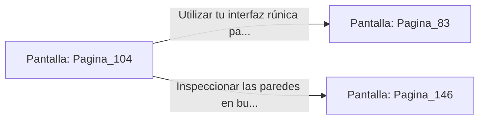

# 📺 Nodo Pantalla: `Pagina_104`

[[Index|⬅️ Índice]] | Fichero Origen: [[sample_eligejuego-code_capitulo_06_mpl|📄 sample/eligejuego-code/capitulo_06.mpl]]

**Narrativa y Encabezado:**
> PÁGINA 104: EL PASILLO DE LAS TRAMPAS DE PRESIÓN
> 
> Avanzas con extrema concentración, identificando los ligeros relieves de las losas mecánicas del suelo. Tu entrenamiento te permite sortear cada mecanismo con precisión quirúrgica.
> 
> Alcanzas el extremo opuesto del pasillo donde se halla la puerta blindada que da acceso a la antesala de la Fosa de los Juramentos.

## 📋 Desglose de Instrucciones de Opciones
### `OPCION "Utilizar tu interfaz rúnica para abrir la antesala de la Fosa" CON_ACCION TRANSICIONAR_A Pagina_83`
* **Instrucción:** `OPCION` *(Manual: Mapea una entrada o botón interactivo de usuario. Vincular una acción como la invocación de una función C1, un método C2 o una transición C3.)*
* **Efecto de Control:** Dispara `TRANSICIONAR_A` hacia [[Pantalla_Pagina_83|📺 Pagina_83]]
### `OPCION "Inspeccionar las paredes en busca de controles de desactivación" CON_ACCION TRANSICIONAR_A Pagina_146`
* **Instrucción:** `OPCION` *(Manual: Mapea una entrada o botón interactivo de usuario. Vincular una acción como la invocación de una función C1, un método C2 o una transición C3.)*
* **Efecto de Control:** Dispara `TRANSICIONAR_A` hacia [[Pantalla_Pagina_146|📺 Pagina_146]]

## 📊 Diagrama de Flujo e Interacción (Mermaid)

