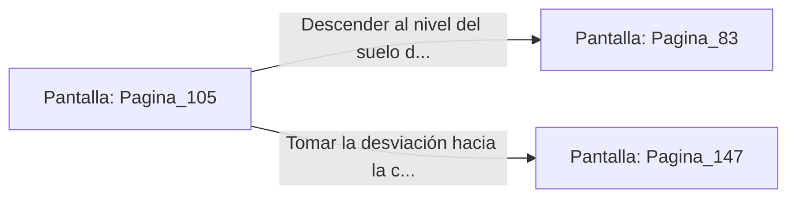

# 📺 Nodo Pantalla: `Pagina_105`

[[Index|⬅️ Índice]] | Fichero Origen: [[sample_eligejuego-code_capitulo_06_mpl|📄 sample/eligejuego-code/capitulo_06.mpl]]

**Narrativa y Encabezado:**
> PÁGINA 105: LA ESCALINATA DE CARACOL
> 
> Desciendes en círculos concéntricos por la angosta escalinata de piedra negra. Las paredes están frías y húmedas, salpicadas por musgo bioluminiscente que emite un tenue resplandor azulado.
> 
> A medida que bajas, el eco de cánticos antiguos y el choque de espadas de fase se vuelve más nítido, indicándote que estás muy cerca del terreno de combate de la fosa.
> 
> Un descansillo intermedio te ofrece dos alternativas: continuar bajando hasta el nivel del suelo de la fosa o acceder a la cornisa superior de los arqueros.

## 📋 Desglose de Instrucciones de Opciones
### `OPCION "Descender al nivel del suelo de la Fosa de los Juramentos" CON_ACCION TRANSICIONAR_A Pagina_83`
* **Instrucción:** `OPCION` *(Manual: Mapea una entrada o botón interactivo de usuario. Vincular una acción como la invocación de una función C1, un método C2 o una transición C3.)*
* **Efecto de Control:** Dispara `TRANSICIONAR_A` hacia [[Pantalla_Pagina_83|📺 Pagina_83]]
### `OPCION "Tomar la desviación hacia la cornisa superior de los arqueros" CON_ACCION TRANSICIONAR_A Pagina_147`
* **Instrucción:** `OPCION` *(Manual: Mapea una entrada o botón interactivo de usuario. Vincular una acción como la invocación de una función C1, un método C2 o una transición C3.)*
* **Efecto de Control:** Dispara `TRANSICIONAR_A` hacia [[Pantalla_Pagina_147|📺 Pagina_147]]

## 📊 Diagrama de Flujo e Interacción (Mermaid)

