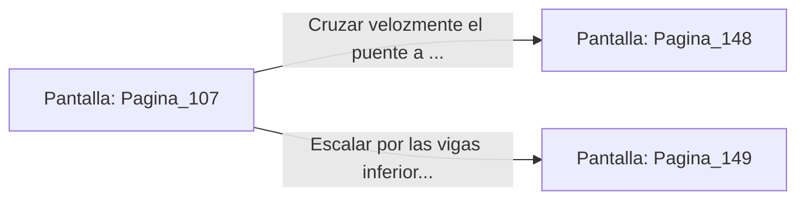

# 📺 Nodo Pantalla: `Pagina_107`

[[Index|⬅️ Índice]] | Fichero Origen: [[sample_eligejuego-code_capitulo_06_mpl|📄 sample/eligejuego-code/capitulo_06.mpl]]

**Narrativa y Encabezado:**
> PÁGINA 107: APAGÓN EN EL PUENTE
> 
> Alineas la mira del cañón de riel sobre el núcleo del generador secundario y tiras del gatillo. Un rayo de masa cinética atraviesa la estructura, provocando una explosión azulina que desactiva las luces y los sensores del puente exterior.
> 
> Sumidos en la penumbra total, los autómatas de patrulla pierden sus fijaciones de objetivo y comienzan a deambular sin rumbo fijo.
> 
> Aprovechas la oscuridad para cruzar el puente velozmente a pie o escalar por las vigas estructurales inferiores.

## 📋 Desglose de Instrucciones de Opciones
### `OPCION "Cruzar velozmente el puente a pie aprovechando la penumbra" CON_ACCION TRANSICIONAR_A Pagina_148`
* **Instrucción:** `OPCION` *(Manual: Mapea una entrada o botón interactivo de usuario. Vincular una acción como la invocación de una función C1, un método C2 o una transición C3.)*
* **Efecto de Control:** Dispara `TRANSICIONAR_A` hacia [[Pantalla_Pagina_148|📺 Pagina_148]]
### `OPCION "Escalar por las vigas inferiores del puente para mayor seguridad" CON_ACCION TRANSICIONAR_A Pagina_149`
* **Instrucción:** `OPCION` *(Manual: Mapea una entrada o botón interactivo de usuario. Vincular una acción como la invocación de una función C1, un método C2 o una transición C3.)*
* **Efecto de Control:** Dispara `TRANSICIONAR_A` hacia [[Pantalla_Pagina_149|📺 Pagina_149]]

## 📊 Diagrama de Flujo e Interacción (Mermaid)

