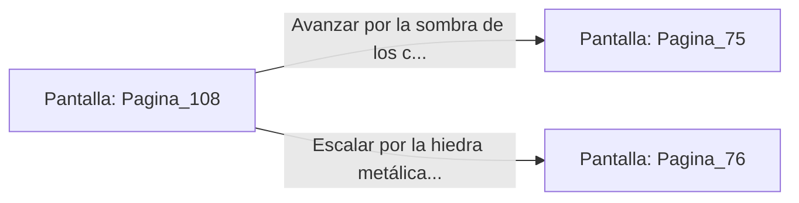

# 📺 Nodo Pantalla: `Pagina_108`

[[Index|⬅️ Índice]] | Fichero Origen: [[sample_eligejuego-code_capitulo_06_mpl|📄 sample/eligejuego-code/capitulo_06.mpl]]

**Narrativa y Encabezado:**
> PÁGINA 108: EL ARCO HACIA LOS BASTIONES
> 
> Cruzas el majestuoso arco de piedra decorado con los blasones de Aethelgard y dejas atrás la humedad del invernadero. Ante ti se despliega la explanada de acceso a las murallas del Bastión de Guerra.
> 
> Un escuadrón de la guardia realiza maniobras en el patio, pero la sombra de los contrafuertes te brinda cobertura suficiente para avanzar.

## 📋 Desglose de Instrucciones de Opciones
### `OPCION "Avanzar por la sombra de los contrafuertes hacia la poterna" CON_ACCION TRANSICIONAR_A Pagina_75`
* **Instrucción:** `OPCION` *(Manual: Mapea una entrada o botón interactivo de usuario. Vincular una acción como la invocación de una función C1, un método C2 o una transición C3.)*
* **Efecto de Control:** Dispara `TRANSICIONAR_A` hacia [[Pantalla_Pagina_75|📺 Pagina_75]]
### `OPCION "Escalar por la hiedra metálica hacia las almenas superiores" CON_ACCION TRANSICIONAR_A Pagina_76`
* **Instrucción:** `OPCION` *(Manual: Mapea una entrada o botón interactivo de usuario. Vincular una acción como la invocación de una función C1, un método C2 o una transición C3.)*
* **Efecto de Control:** Dispara `TRANSICIONAR_A` hacia [[Pantalla_Pagina_76|📺 Pagina_76]]

## 📊 Diagrama de Flujo e Interacción (Mermaid)

