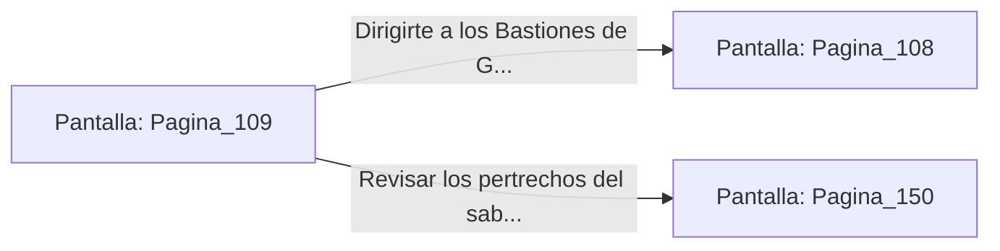

# 📺 Nodo Pantalla: `Pagina_109`

[[Index|⬅️ Índice]] | Fichero Origen: [[sample_eligejuego-code_capitulo_06_mpl|📄 sample/eligejuego-code/capitulo_06.mpl]]

**Narrativa y Encabezado:**
> PÁGINA 109: LA CÁMARA TRAS LAS RAÍCES
> 
> Te abres paso entre las raíces bioluminiscentes y descubres un nicho secreto excavado en la roca. En su interior descansa el esqueleto de un antiguo sabio que aún conserva en sus manos un pergamino de tela incombustible.
> 
> Al desenrollar el manuscrito, lees los planos detallados del sistema de refrigeración del Núcleo de Éter y la ubicación de su válvula de emergencia.
> 
> Con esta valiosa información registrada en tu Brazal, retomas el camino hacia los Bastiones de Guerra.

## 📋 Desglose de Instrucciones de Opciones
### `OPCION "Dirigirte a los Bastiones de Guerra con los planos del refrigerante" CON_ACCION TRANSICIONAR_A Pagina_108`
* **Instrucción:** `OPCION` *(Manual: Mapea una entrada o botón interactivo de usuario. Vincular una acción como la invocación de una función C1, un método C2 o una transición C3.)*
* **Efecto de Control:** Dispara `TRANSICIONAR_A` hacia [[Pantalla_Pagina_108|📺 Pagina_108]]
### `OPCION "Revisar los pertrechos del sabio antes de marcharte" CON_ACCION TRANSICIONAR_A Pagina_150`
* **Instrucción:** `OPCION` *(Manual: Mapea una entrada o botón interactivo de usuario. Vincular una acción como la invocación de una función C1, un método C2 o una transición C3.)*
* **Efecto de Control:** Dispara `TRANSICIONAR_A` hacia [[Pantalla_Pagina_150|📺 Pagina_150]]

## 📊 Diagrama de Flujo e Interacción (Mermaid)

