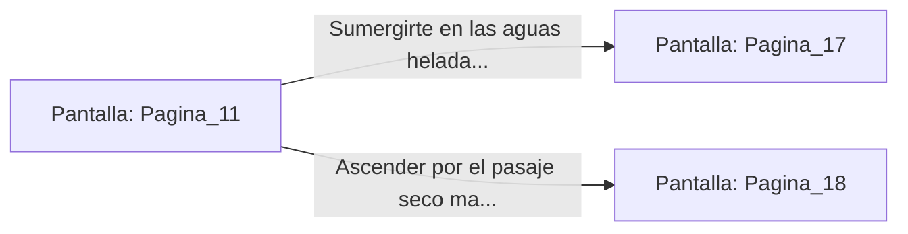

# 📺 Nodo Pantalla: `Pagina_11`

[[Index|⬅️ Índice]] | Fichero Origen: [[sample_eligejuego-code_capitulo_02_mpl|📄 sample/eligejuego-code/capitulo_02.mpl]]

**Narrativa y Encabezado:**
> PÁGINA 11: LAS CATACUMBAS SUMERGIDAS
> 
> Bajas por los peldaños resbaladizos hasta que el agua helada te llega a las rodillas. El silencio aquí es sobrecogedor, interrumpido únicamente por el goteo constante desde las bóvedas de piedra negra y el eco de tus propios pasos. A lo largo de las paredes se alinean nichos excavados en la roca donde descansan los restos mineralizados de los Antiguos Sabios.
> 
> Al avanzar unos metros, una luz azulada emerge del fondo del estanque acuático. El Brazal de Convergencia reacciona emitiendo una vibración armónica: bajo la superficie líquida se divisa un arcón de aleación militar, cubierto de algas luminiscentes pero intacto tras los siglos. Sin embargo, a tu derecha, un pasaje seco marcado con la runa del Fuego Eterno asciende hacia una sala de máquinas.
> 
> Debes decidir rápido si sumergirte para inspeccionar el arcón sumergido o ignorarlo y buscar refugio en el pasaje seco.

## 📋 Desglose de Instrucciones de Opciones
### `OPCION "Sumergirte en las aguas heladas para abrir el arcón militar" CON_ACCION TRANSICIONAR_A Pagina_17`
* **Instrucción:** `OPCION` *(Manual: Mapea una entrada o botón interactivo de usuario. Vincular una acción como la invocación de una función C1, un método C2 o una transición C3.)*
* **Efecto de Control:** Dispara `TRANSICIONAR_A` hacia [[Pantalla_Pagina_17|📺 Pagina_17]]
### `OPCION "Ascender por el pasaje seco marcado con la runa de Fuego" CON_ACCION TRANSICIONAR_A Pagina_18`
* **Instrucción:** `OPCION` *(Manual: Mapea una entrada o botón interactivo de usuario. Vincular una acción como la invocación de una función C1, un método C2 o una transición C3.)*
* **Efecto de Control:** Dispara `TRANSICIONAR_A` hacia [[Pantalla_Pagina_18|📺 Pagina_18]]

## 📊 Diagrama de Flujo e Interacción (Mermaid)

