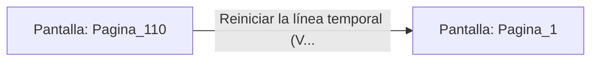

# 📺 Nodo Pantalla: `Pagina_110`

[[Index|⬅️ Índice]] | Fichero Origen: [[sample_eligejuego-code_capitulo_06_mpl|📄 sample/eligejuego-code/capitulo_06.mpl]]

**Narrativa y Encabezado:**
> PÁGINA 110: CAPTURA EN EL PATIO
> 
> Sales del carro de suministros sin la precaución debida. Un centinela de élite te detecta inmediatamente y activa su red de contención magnética, inmovilizándote hasta la llegada de Malakor, quien te ejecuta sin piedad.

## 📋 Desglose de Instrucciones de Opciones
### `OPCION "Reiniciar la línea temporal (Volver al Inicio)" CON_ACCION TRANSICIONAR_A Pagina_1`
* **Instrucción:** `OPCION` *(Manual: Mapea una entrada o botón interactivo de usuario. Vincular una acción como la invocación de una función C1, un método C2 o una transición C3.)*
* **Efecto de Control:** Dispara `TRANSICIONAR_A` hacia [[Pantalla_Pagina_1|📺 Pagina_1]]

## 📊 Diagrama de Flujo e Interacción (Mermaid)

