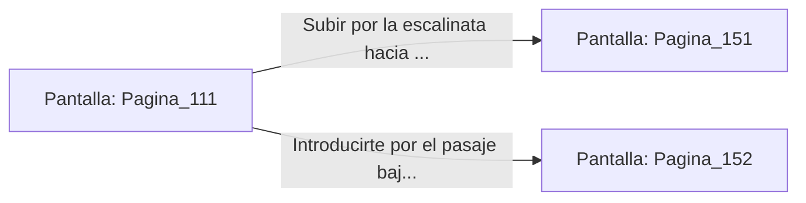

# 📺 Nodo Pantalla: `Pagina_111`

[[Index|⬅️ Índice]] | Fichero Origen: [[sample_eligejuego-code_capitulo_07_mpl|📄 sample/eligejuego-code/capitulo_07.mpl]]

**Narrativa y Encabezado:**
> PÁGINA 111: HUMO EN EL PATIO DE ARMAS
> 
> Lanzas la granada de humo denso desde el interior del carro de suministros. En cuestión de segundos, una densa niebla opaca envuelve el patio de armas, cegando los visores térmicos de los guardias de élite y desatando el caos entre sus filas.
> 
> Aprovechando la confusión, te deslizas bajo el chasis del vehículo y corres pegado a los soportes de piedra hasta alcanzar la escalinata que conduce a la armería central o al corredor de los sirvientes.
> 
> Con la alarma retumbando por todo el complejo, debes elegir rápidamente qué vía tomar antes de que el humo se disipe.

## 📋 Desglose de Instrucciones de Opciones
### `OPCION "Subir por la escalinata hacia la Armería Central" CON_ACCION TRANSICIONAR_A Pagina_151`
* **Instrucción:** `OPCION` *(Manual: Mapea una entrada o botón interactivo de usuario. Vincular una acción como la invocación de una función C1, un método C2 o una transición C3.)*
* **Efecto de Control:** Dispara `TRANSICIONAR_A` hacia [[Pantalla_Pagina_151|📺 Pagina_151]]
### `OPCION "Introducirte por el pasaje bajo de los sirvientes" CON_ACCION TRANSICIONAR_A Pagina_152`
* **Instrucción:** `OPCION` *(Manual: Mapea una entrada o botón interactivo de usuario. Vincular una acción como la invocación de una función C1, un método C2 o una transición C3.)*
* **Efecto de Control:** Dispara `TRANSICIONAR_A` hacia [[Pantalla_Pagina_152|📺 Pagina_152]]

## 📊 Diagrama de Flujo e Interacción (Mermaid)

