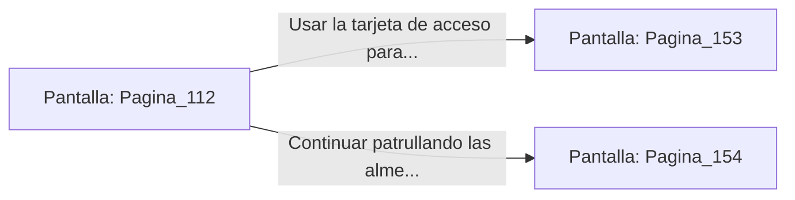

# 📺 Nodo Pantalla: `Pagina_112`

[[Index|⬅️ Índice]] | Fichero Origen: [[sample_eligejuego-code_capitulo_07_mpl|📄 sample/eligejuego-code/capitulo_07.mpl]]

**Narrativa y Encabezado:**
> PÁGINA 112: ATAQUE SILENCIOSO EN LA ALMENA
> 
> Te desatraviesas por la espalda del centinela e inyectas una carga de parálisis con la hoja oculta de tu Brazal. La unidad cae inerte sin emitir la menor señal de alerta a la red central.
> 
> Registras su cinturón táctico y recuperas una Célula de Éter Sobrecargada y una tarjeta de acceso de la Guardia Real.

## 📋 Desglose de Instrucciones de Opciones
### `OPCION "Usar la tarjeta de acceso para abrir la puerta de la Torre de Mando" CON_ACCION TRANSICIONAR_A Pagina_153`
* **Instrucción:** `OPCION` *(Manual: Mapea una entrada o botón interactivo de usuario. Vincular una acción como la invocación de una función C1, un método C2 o una transición C3.)*
* **Efecto de Control:** Dispara `TRANSICIONAR_A` hacia [[Pantalla_Pagina_153|📺 Pagina_153]]
### `OPCION "Continuar patrullando las almenas hacia el Bastión Central" CON_ACCION TRANSICIONAR_A Pagina_154`
* **Instrucción:** `OPCION` *(Manual: Mapea una entrada o botón interactivo de usuario. Vincular una acción como la invocación de una función C1, un método C2 o una transición C3.)*
* **Efecto de Control:** Dispara `TRANSICIONAR_A` hacia [[Pantalla_Pagina_154|📺 Pagina_154]]

## 📊 Diagrama de Flujo e Interacción (Mermaid)

