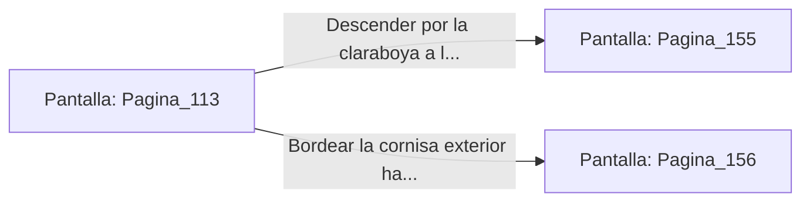

# 📺 Nodo Pantalla: `Pagina_113`

[[Index|⬅️ Índice]] | Fichero Origen: [[sample_eligejuego-code_capitulo_07_mpl|📄 sample/eligejuego-code/capitulo_07.mpl]]

**Narrativa y Encabezado:**
> PÁGINA 113: EL PASO DE RONDA INTERNO
> 
> Saltas con agilidad desde la muralla al tejado de pizarra del paso de ronda. Las tejas crujen ligeramente bajo tus botas, pero el estruendo de la tormenta de éter amortigua cualquier ruido sospechoso.
> 
> Desde tu posición observas las patrullas enemigas agrupándose en la plaza de armas. En el extremo opuesto del tejado, una clara claraboya permanece entornada, permitiendo la entrada directa a las dependencias de los oficiales.
> 
> Tienes la opción de descender por la claraboya hacia los aposentos de los oficiales o bordear la cornisa hacia el hangar de naves tácticas.

## 📋 Desglose de Instrucciones de Opciones
### `OPCION "Descender por la claraboya a los Aposentos de Oficiales" CON_ACCION TRANSICIONAR_A Pagina_155`
* **Instrucción:** `OPCION` *(Manual: Mapea una entrada o botón interactivo de usuario. Vincular una acción como la invocación de una función C1, un método C2 o una transición C3.)*
* **Efecto de Control:** Dispara `TRANSICIONAR_A` hacia [[Pantalla_Pagina_155|📺 Pagina_155]]
### `OPCION "Bordear la cornisa exterior hacia el Hangar Táctico" CON_ACCION TRANSICIONAR_A Pagina_156`
* **Instrucción:** `OPCION` *(Manual: Mapea una entrada o botón interactivo de usuario. Vincular una acción como la invocación de una función C1, un método C2 o una transición C3.)*
* **Efecto de Control:** Dispara `TRANSICIONAR_A` hacia [[Pantalla_Pagina_156|📺 Pagina_156]]

## 📊 Diagrama de Flujo e Interacción (Mermaid)

