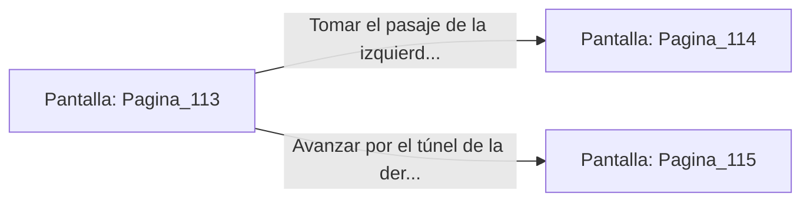

# 📺 Nodo Pantalla: `Pagina_113`

[[Index|⬅️ Índice]] | Fichero Origen: [[sample_eligejuego-code_capitulo_02_catacumbas_mpl|📄 sample/eligejuego-code/capitulo_02_catacumbas.mpl]]

**Narrativa y Encabezado:**
> Página 113: Las Catacumbas Anegadas
> 
> El agua negra te llega hasta los tobillos. Sombras informe flotan bajo la superficie helada. Te encuentras ante una encrucijada en la penumbra de la mazmorra. Debes tomar una decisión.

## 📋 Desglose de Instrucciones de Opciones
### `OPCION "Tomar el pasaje de la izquierda (Página 114)" CON_ACCION TRANSICIONAR_A Pagina_114`
* **Instrucción:** `OPCION` *(Manual: Mapea una entrada o botón interactivo de usuario. Vincular una acción como la invocación de una función C1, un método C2 o una transición C3.)*
* **Efecto de Control:** Dispara `TRANSICIONAR_A` hacia [[Pantalla_Pagina_114|📺 Pagina_114]]
### `OPCION "Avanzar por el túnel de la derecha (Página 115)" CON_ACCION TRANSICIONAR_A Pagina_115`
* **Instrucción:** `OPCION` *(Manual: Mapea una entrada o botón interactivo de usuario. Vincular una acción como la invocación de una función C1, un método C2 o una transición C3.)*
* **Efecto de Control:** Dispara `TRANSICIONAR_A` hacia [[Pantalla_Pagina_115|📺 Pagina_115]]

## 📊 Diagrama de Flujo e Interacción (Mermaid)

