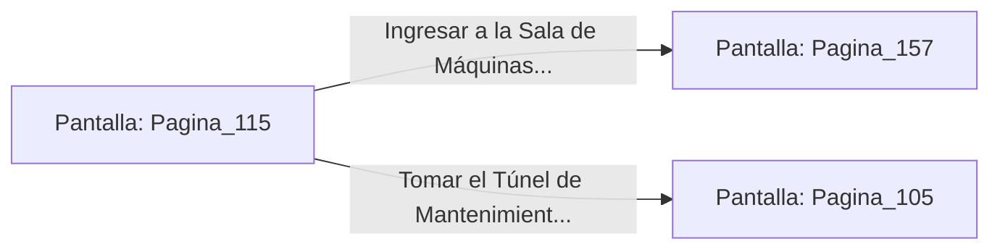

# 📺 Nodo Pantalla: `Pagina_115`

[[Index|⬅️ Índice]] | Fichero Origen: [[sample_eligejuego-code_capitulo_07_mpl|📄 sample/eligejuego-code/capitulo_07.mpl]]

**Narrativa y Encabezado:**
> PÁGINA 115: EL SALTO SOBRE LA DESCARGA
> 
> Te impulsas con fuerza sobre el borde de la pasarela y cruzas volando por encima del chorro de vapor térmico. Tu Brazal de Convergencia despliega una breve pantalla deflectora que amortigua el calor radiante durante el trayecto.
> 
> Aterrizas al otro lado rodando sobre el suelo de rejilla metálica, sano y salvo aunque con la armadura caliente al tacto. El camino despejado conduce directamente a la Sala de Máquinas Principales.
> 
> Frente a ti se abren dos puertas: la entrada al Nivel de los Calderos o el acceso directo al Túnel de Mantenimiento de la Fosa.

## 📋 Desglose de Instrucciones de Opciones
### `OPCION "Ingresar a la Sala de Máquinas Principales" CON_ACCION TRANSICIONAR_A Pagina_157`
* **Instrucción:** `OPCION` *(Manual: Mapea una entrada o botón interactivo de usuario. Vincular una acción como la invocación de una función C1, un método C2 o una transición C3.)*
* **Efecto de Control:** Dispara `TRANSICIONAR_A` hacia [[Pantalla_Pagina_157|📺 Pagina_157]]
### `OPCION "Tomar el Túnel de Mantenimiento hacia la Fosa" CON_ACCION TRANSICIONAR_A Pagina_105`
* **Instrucción:** `OPCION` *(Manual: Mapea una entrada o botón interactivo de usuario. Vincular una acción como la invocación de una función C1, un método C2 o una transición C3.)*
* **Efecto de Control:** Dispara `TRANSICIONAR_A` hacia [[Pantalla_Pagina_105|📺 Pagina_105]]

## 📊 Diagrama de Flujo e Interacción (Mermaid)

