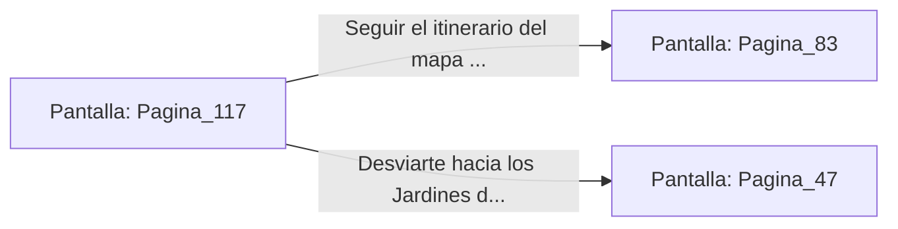

# 📺 Nodo Pantalla: `Pagina_117`

[[Index|⬅️ Índice]] | Fichero Origen: [[sample_eligejuego-code_capitulo_07_mpl|📄 sample/eligejuego-code/capitulo_07.mpl]]

**Narrativa y Encabezado:**
> PÁGINA 117: PERFIL BAJO EN LAS GALERÍAS
> 
> Decides dejar atrás el armamento pesado para primar la agilidad y el sigilo. Guardas únicamente el mapa holográfico en la memoria de tu Brazal y avanzas en silencio entre los bastidores.
> 
> El mapa despliega un itinerario seguro que rodea las patrullas principales de la guarnición a través de los viejos conductos de aire. Gracias a esta ruta, ganas tiempo sin levantar alarmas.
> 
> El conducto finaliza en una intersección que da acceso a la Fosa de los Juramentos o a los Jardines de Cristal.

## 📋 Desglose de Instrucciones de Opciones
### `OPCION "Seguir el itinerario del mapa hacia la Fosa de los Juramentos" CON_ACCION TRANSICIONAR_A Pagina_83`
* **Instrucción:** `OPCION` *(Manual: Mapea una entrada o botón interactivo de usuario. Vincular una acción como la invocación de una función C1, un método C2 o una transición C3.)*
* **Efecto de Control:** Dispara `TRANSICIONAR_A` hacia [[Pantalla_Pagina_83|📺 Pagina_83]]
### `OPCION "Desviarte hacia los Jardines de Cristal" CON_ACCION TRANSICIONAR_A Pagina_47`
* **Instrucción:** `OPCION` *(Manual: Mapea una entrada o botón interactivo de usuario. Vincular una acción como la invocación de una función C1, un método C2 o una transición C3.)*
* **Efecto de Control:** Dispara `TRANSICIONAR_A` hacia [[Pantalla_Pagina_47|📺 Pagina_47]]

## 📊 Diagrama de Flujo e Interacción (Mermaid)

