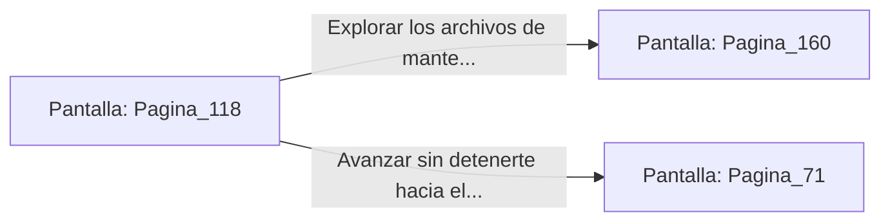

# 📺 Nodo Pantalla: `Pagina_118`

[[Index|⬅️ Índice]] | Fichero Origen: [[sample_eligejuego-code_capitulo_07_mpl|📄 sample/eligejuego-code/capitulo_07.mpl]]

**Narrativa y Encabezado:**
> PÁGINA 118: LA PASARELA DE MANTENIMIENTO
> 
> Logras encaramarte a la pasarela de mantenimiento y abres la puerta rúnica mediante una descarga de frecuencia de tu Brazal. La puerta se cierra tras de ti, aislando el humo y las llamas del ascensor destruido.
> 
> Te encuentras en un pasillo abovedado de piedra pulida donde se alinean los antiguos archivos de mantenimiento del sector.

## 📋 Desglose de Instrucciones de Opciones
### `OPCION "Explorar los archivos de mantenimiento en busca de claves de acceso" CON_ACCION TRANSICIONAR_A Pagina_160`
* **Instrucción:** `OPCION` *(Manual: Mapea una entrada o botón interactivo de usuario. Vincular una acción como la invocación de una función C1, un método C2 o una transición C3.)*
* **Efecto de Control:** Dispara `TRANSICIONAR_A` hacia [[Pantalla_Pagina_160|📺 Pagina_160]]
### `OPCION "Avanzar sin detenerte hacia el Nivel Subterráneo Nueve" CON_ACCION TRANSICIONAR_A Pagina_71`
* **Instrucción:** `OPCION` *(Manual: Mapea una entrada o botón interactivo de usuario. Vincular una acción como la invocación de una función C1, un método C2 o una transición C3.)*
* **Efecto de Control:** Dispara `TRANSICIONAR_A` hacia [[Pantalla_Pagina_71|📺 Pagina_71]]

## 📊 Diagrama de Flujo e Interacción (Mermaid)

