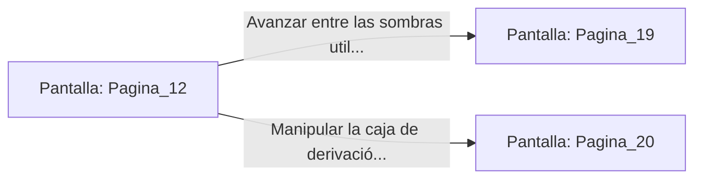

# 📺 Nodo Pantalla: `Pagina_12`

[[Index|⬅️ Índice]] | Fichero Origen: [[sample_eligejuego-code_capitulo_02_mpl|📄 sample/eligejuego-code/capitulo_02.mpl]]

**Narrativa y Encabezado:**
> PÁGINA 12: LA GALERÍA DE LOS AUTÓMATAS
> 
> La escalera en espiral desemboca en una vasta nave industrial sustentada por columnas de hierro forjado. Alineados a ambos lados de la estancia, docenas de autómatas de combate permanecen erguidos en nichos de recarga. Aunque parecen inactivos, el parpadeo tenue de sus núcleos de éter sugiere que el protocolo de guardia aún no se ha extinguido del todo.
> 
> Caminas sobre una pasarela elevada procurando no hacer sonar tus botas contra la rejilla. Al final de la galería, una consola central de control mantiene encendidas sus pantallas holográficas, mostrando mapas del flujo temporal del complejo. No obstante, una sombra biomecánica de tres metros de altura se interpone entre la consola y tú.
> 
> Puedes intentar infiltrarte sigilosamente usando los paneles de sombra o programar una sobrecarga de línea desde una caja de derivación cercana para desactivar al guardián.

## 📋 Desglose de Instrucciones de Opciones
### `OPCION "Avanzar entre las sombras utilizando la cobertura de los nichos" CON_ACCION TRANSICIONAR_A Pagina_19`
* **Instrucción:** `OPCION` *(Manual: Mapea una entrada o botón interactivo de usuario. Vincular una acción como la invocación de una función C1, un método C2 o una transición C3.)*
* **Efecto de Control:** Dispara `TRANSICIONAR_A` hacia [[Pantalla_Pagina_19|📺 Pagina_19]]
### `OPCION "Manipular la caja de derivación para provocar un cortocircuito" CON_ACCION TRANSICIONAR_A Pagina_20`
* **Instrucción:** `OPCION` *(Manual: Mapea una entrada o botón interactivo de usuario. Vincular una acción como la invocación de una función C1, un método C2 o una transición C3.)*
* **Efecto de Control:** Dispara `TRANSICIONAR_A` hacia [[Pantalla_Pagina_20|📺 Pagina_20]]

## 📊 Diagrama de Flujo e Interacción (Mermaid)

