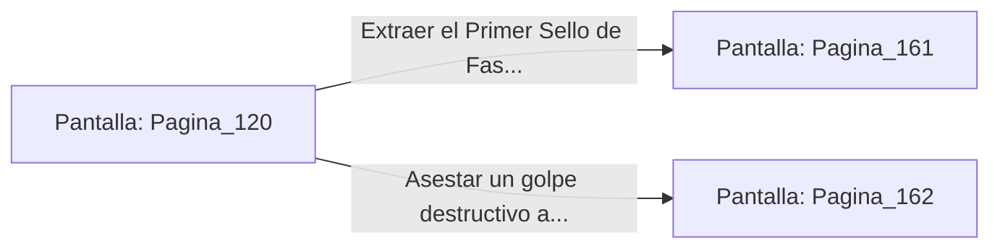

# 📺 Nodo Pantalla: `Pagina_120`

[[Index|⬅️ Índice]] | Fichero Origen: [[sample_eligejuego-code_capitulo_07_mpl|📄 sample/eligejuego-code/capitulo_07.mpl]]

**Narrativa y Encabezado:**
> PÁGINA 120: LA DESACTIVACIÓN DEL ESPECTRO
> 
> Pronuncias la contraseña mnemónica con voz firme. El escudo del Espectro Temporal parpadea y colapsa con un agudo zumbido, dejándolo indefenso durante diez valiosos segundos.
> 
> Aprovechas la ventana de oportunidad para abalanzarte sobre la reliquia y extraer el Primer Sello de Fase del pedestal.

## 📋 Desglose de Instrucciones de Opciones
### `OPCION "Extraer el Primer Sello de Fase y asegurar tu inventario" CON_ACCION TRANSICIONAR_A Pagina_161`
* **Instrucción:** `OPCION` *(Manual: Mapea una entrada o botón interactivo de usuario. Vincular una acción como la invocación de una función C1, un método C2 o una transición C3.)*
* **Efecto de Control:** Dispara `TRANSICIONAR_A` hacia [[Pantalla_Pagina_161|📺 Pagina_161]]
### `OPCION "Asestar un golpe destructivo al Espectro aturdido antes de huir" CON_ACCION TRANSICIONAR_A Pagina_162`
* **Instrucción:** `OPCION` *(Manual: Mapea una entrada o botón interactivo de usuario. Vincular una acción como la invocación de una función C1, un método C2 o una transición C3.)*
* **Efecto de Control:** Dispara `TRANSICIONAR_A` hacia [[Pantalla_Pagina_162|📺 Pagina_162]]

## 📊 Diagrama de Flujo e Interacción (Mermaid)

