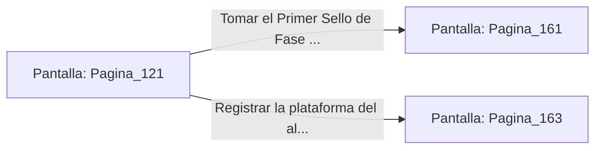

# 📺 Nodo Pantalla: `Pagina_121`

[[Index|⬅️ Índice]] | Fichero Origen: [[sample_eligejuego-code_capitulo_07_mpl|📄 sample/eligejuego-code/capitulo_07.mpl]]

**Narrativa y Encabezado:**
> PÁGINA 121: COMBATE CONTRA EL ESPECTRO
> 
> Desenfundas tu arma de fase e inicias un cruento duelo contra el Espectro Temporal en el centro de la fosa. Sus mandobles de luz estelar cortan el aire con ráfagas de energía que agrietan las estatuas de piedra de la sala.
> 
> Gracias a los reflejos potenciados de tu Brazal, esquivas sus embestidas pesadas y localizas una brecha en la base de su armadura astral. Con un estocado preciso, atraviesas su núcleo energizado.
> 
> El espectro se disipa en una densa nube de chispas violetas, dejando libre el acceso al Primer Sello de Fase.

## 📋 Desglose de Instrucciones de Opciones
### `OPCION "Tomar el Primer Sello de Fase y avanzar hacia los Jardines" CON_ACCION TRANSICIONAR_A Pagina_161`
* **Instrucción:** `OPCION` *(Manual: Mapea una entrada o botón interactivo de usuario. Vincular una acción como la invocación de una función C1, un método C2 o una transición C3.)*
* **Efecto de Control:** Dispara `TRANSICIONAR_A` hacia [[Pantalla_Pagina_161|📺 Pagina_161]]
### `OPCION "Registrar la plataforma del altar en busca de objetos arcanos" CON_ACCION TRANSICIONAR_A Pagina_163`
* **Instrucción:** `OPCION` *(Manual: Mapea una entrada o botón interactivo de usuario. Vincular una acción como la invocación de una función C1, un método C2 o una transición C3.)*
* **Efecto de Control:** Dispara `TRANSICIONAR_A` hacia [[Pantalla_Pagina_163|📺 Pagina_163]]

## 📊 Diagrama de Flujo e Interacción (Mermaid)

