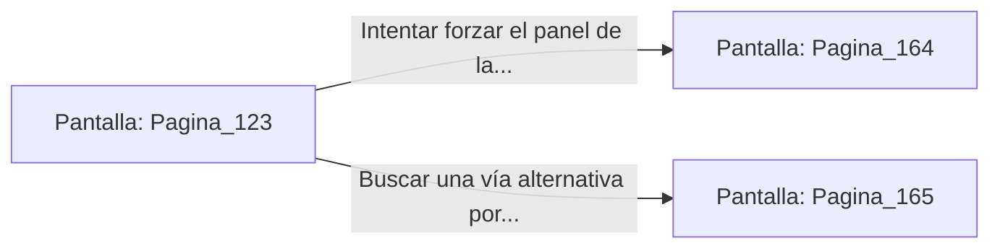

# 📺 Nodo Pantalla: `Pagina_123`

[[Index|⬅️ Índice]] | Fichero Origen: [[sample_eligejuego-code_capitulo_07_mpl|📄 sample/eligejuego-code/capitulo_07.mpl]]

**Narrativa y Encabezado:**
> PÁGINA 123: LA ESCALERA REAL
> 
> Asciendes por los anchos escalones de mármol blanco cubiertos por una alfombra carmesí corroída por el tiempo. A lo largo de la subiría se erigen frescos que retratan la gloria del antiguo imperio y su trágico colapso.
> 
> Al llegar al descansillo superior, te encuentras frente a la imponente Puerta de los Cien Cerrojos, la cual custodia la entrada directa a la Sala del Trono de Malakor.
> 
> Un panel de control secundario permite intentar forzar la secuencia de apertura o buscar un pasaje alternativo por las balconadas exteriores.

## 📋 Desglose de Instrucciones de Opciones
### `OPCION "Intentar forzar el panel de la Puerta de los Cien Cerrojos" CON_ACCION TRANSICIONAR_A Pagina_164`
* **Instrucción:** `OPCION` *(Manual: Mapea una entrada o botón interactivo de usuario. Vincular una acción como la invocación de una función C1, un método C2 o una transición C3.)*
* **Efecto de Control:** Dispara `TRANSICIONAR_A` hacia [[Pantalla_Pagina_164|📺 Pagina_164]]
### `OPCION "Buscar una vía alternativa por las balconadas exteriores" CON_ACCION TRANSICIONAR_A Pagina_165`
* **Instrucción:** `OPCION` *(Manual: Mapea una entrada o botón interactivo de usuario. Vincular una acción como la invocación de una función C1, un método C2 o una transición C3.)*
* **Efecto de Control:** Dispara `TRANSICIONAR_A` hacia [[Pantalla_Pagina_165|📺 Pagina_165]]

## 📊 Diagrama de Flujo e Interacción (Mermaid)

