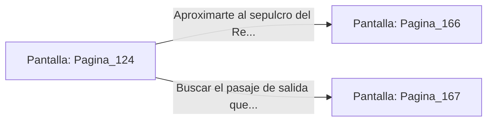

# 📺 Nodo Pantalla: `Pagina_124`

[[Index|⬅️ Índice]] | Fichero Origen: [[sample_eligejuego-code_capitulo_07_mpl|📄 sample/eligejuego-code/capitulo_07.mpl]]

**Narrativa y Encabezado:**
> PÁGINA 124: LA CRIPTA DE LOS REYES OLVIDADOS
> 
> Desciendes a la penumbra de la cripta subterránea donde yacen los sarcófagos de titanio de los antiguos monarcas. Un silencio sagrado envuelve las naves de piedra negra.
> 
> En el centro de la cámara, el sepulcro del Rey Fundador emite una tenue vibración en sintonía con la frecuencia de tu Brazal.

## 📋 Desglose de Instrucciones de Opciones
### `OPCION "Aproximarte al sepulcro del Rey Fundador para examinarlo" CON_ACCION TRANSICIONAR_A Pagina_166`
* **Instrucción:** `OPCION` *(Manual: Mapea una entrada o botón interactivo de usuario. Vincular una acción como la invocación de una función C1, un método C2 o una transición C3.)*
* **Efecto de Control:** Dispara `TRANSICIONAR_A` hacia [[Pantalla_Pagina_166|📺 Pagina_166]]
### `OPCION "Buscar el pasaje de salida que conecta con el Bastión" CON_ACCION TRANSICIONAR_A Pagina_167`
* **Instrucción:** `OPCION` *(Manual: Mapea una entrada o botón interactivo de usuario. Vincular una acción como la invocación de una función C1, un método C2 o una transición C3.)*
* **Efecto de Control:** Dispara `TRANSICIONAR_A` hacia [[Pantalla_Pagina_167|📺 Pagina_167]]

## 📊 Diagrama de Flujo e Interacción (Mermaid)

