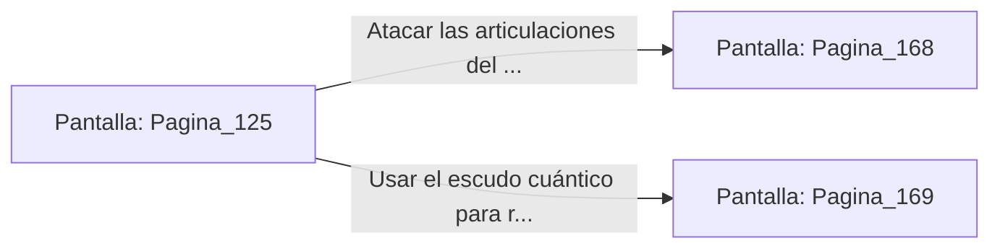

# 📺 Nodo Pantalla: `Pagina_125`

[[Index|⬅️ Índice]] | Fichero Origen: [[sample_eligejuego-code_capitulo_07_mpl|📄 sample/eligejuego-code/capitulo_07.mpl]]

**Narrativa y Encabezado:**
> PÁGINA 125: IRRUPCIÓN EN EL PATIO CENTRAL
> 
> Entras al Patio Central empuñando tus reliquias con determinación. La visión del estoque de luz de los antiguos reyes provoca que varios contingentes de sirvientes abandonen sus puestos y rompan filas.
> 
> Sin embargo, el Comandante de la Guardia de Élite se planta en mitad del patio a bordo de un mecha blindado de asalto, ordenando fuego a discreción contra tu posición.
> 
> Puedes usar la agilidad de tu estoque para buscar las articulaciones del mecha o usar el escudo cuántico para reflejar los proyectiles contra su propio núcleo.

## 📋 Desglose de Instrucciones de Opciones
### `OPCION "Atacar las articulaciones del mecha blindado con tu estoque" CON_ACCION TRANSICIONAR_A Pagina_168`
* **Instrucción:** `OPCION` *(Manual: Mapea una entrada o botón interactivo de usuario. Vincular una acción como la invocación de una función C1, un método C2 o una transición C3.)*
* **Efecto de Control:** Dispara `TRANSICIONAR_A` hacia [[Pantalla_Pagina_168|📺 Pagina_168]]
### `OPCION "Usar el escudo cuántico para reflejar sus disparos al núcleo" CON_ACCION TRANSICIONAR_A Pagina_169`
* **Instrucción:** `OPCION` *(Manual: Mapea una entrada o botón interactivo de usuario. Vincular una acción como la invocación de una función C1, un método C2 o una transición C3.)*
* **Efecto de Control:** Dispara `TRANSICIONAR_A` hacia [[Pantalla_Pagina_169|📺 Pagina_169]]

## 📊 Diagrama de Flujo e Interacción (Mermaid)

