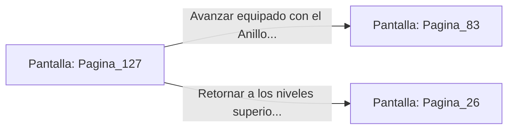

# 📺 Nodo Pantalla: `Pagina_127`

[[Index|⬅️ Índice]] | Fichero Origen: [[sample_eligejuego-code_capitulo_07_mpl|📄 sample/eligejuego-code/capitulo_07.mpl]]

**Narrativa y Encabezado:**
> PÁGINA 127: LAS TUMBAS ANCIANAS
> 
> Exploras los recovecos oscuros de las tumbas antiguas en las catacumbas. Entre los esqueletos mineralizados de los antiguos guardianes, encuentras un cofre de piedra cerrado con un sello de combinación rúnica.
> 
> Utilizas los conocimientos del Brazal para resolver la secuencia de runas, abriendo el cofre que contiene un Anillo de Refracción Arcana capaz de desviar conjuros.
> 
> Con la reliquia equipada en tu mano, continúas con renovadas energías hacia el pasaje de la Fosa.

## 📋 Desglose de Instrucciones de Opciones
### `OPCION "Avanzar equipado con el Anillo de Refracción hacia la Fosa" CON_ACCION TRANSICIONAR_A Pagina_83`
* **Instrucción:** `OPCION` *(Manual: Mapea una entrada o botón interactivo de usuario. Vincular una acción como la invocación de una función C1, un método C2 o una transición C3.)*
* **Efecto de Control:** Dispara `TRANSICIONAR_A` hacia [[Pantalla_Pagina_83|📺 Pagina_83]]
### `OPCION "Retornar a los niveles superiores por la escalera secreta" CON_ACCION TRANSICIONAR_A Pagina_26`
* **Instrucción:** `OPCION` *(Manual: Mapea una entrada o botón interactivo de usuario. Vincular una acción como la invocación de una función C1, un método C2 o una transición C3.)*
* **Efecto de Control:** Dispara `TRANSICIONAR_A` hacia [[Pantalla_Pagina_26|📺 Pagina_26]]

## 📊 Diagrama de Flujo e Interacción (Mermaid)

