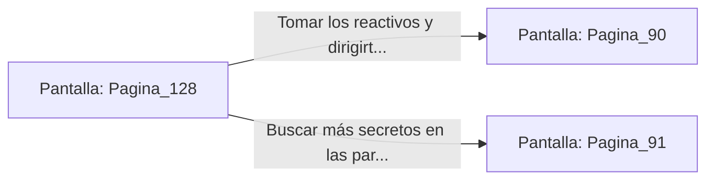

# 📺 Nodo Pantalla: `Pagina_128`

[[Index|⬅️ Índice]] | Fichero Origen: [[sample_eligejuego-code_capitulo_07_mpl|📄 sample/eligejuego-code/capitulo_07.mpl]]

**Narrativa y Encabezado:**
> PÁGINA 128: EL NICHO DE LA GALERÍA
> 
> Investigas el nicho de piedra al final de las inscripciones y descubres un dial de bronce integrado en la pared. Al girarlo, un compartimento oculto se despliega revelando dos frascos de reactivo alquímico.
> 
> Guardas las pociones en tu inventario antes de reanudar tu avance por la red de pasadizos.

## 📋 Desglose de Instrucciones de Opciones
### `OPCION "Tomar los reactivos y dirigirte al Nivel de los Calderos" CON_ACCION TRANSICIONAR_A Pagina_90`
* **Instrucción:** `OPCION` *(Manual: Mapea una entrada o botón interactivo de usuario. Vincular una acción como la invocación de una función C1, un método C2 o una transición C3.)*
* **Efecto de Control:** Dispara `TRANSICIONAR_A` hacia [[Pantalla_Pagina_90|📺 Pagina_90]]
### `OPCION "Buscar más secretos en las paredes vecinas" CON_ACCION TRANSICIONAR_A Pagina_91`
* **Instrucción:** `OPCION` *(Manual: Mapea una entrada o botón interactivo de usuario. Vincular una acción como la invocación de una función C1, un método C2 o una transición C3.)*
* **Efecto de Control:** Dispara `TRANSICIONAR_A` hacia [[Pantalla_Pagina_91|📺 Pagina_91]]

## 📊 Diagrama de Flujo e Interacción (Mermaid)

