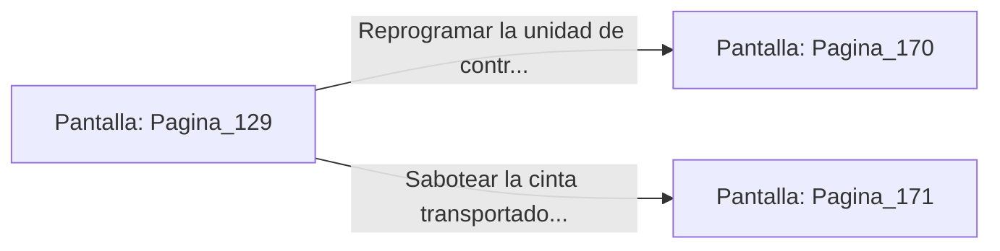

# 📺 Nodo Pantalla: `Pagina_129`

[[Index|⬅️ Índice]] | Fichero Origen: [[sample_eligejuego-code_capitulo_07_mpl|📄 sample/eligejuego-code/capitulo_07.mpl]]

**Narrativa y Encabezado:**
> PÁGINA 129: EL TALLER DE MONTAJE
> 
> Te introduces en la nave del Taller de Montaje de Autómatas. Enormes brazos mecánicos suspendidos del techo ensamblan piezas de titanio y núcleos de éter sobre los chasis de las unidades de combate.
> 
> Una cadena de montaje activa transporta un autómata pesado de asalto recién ensamblado hacia la sala de pruebas. Si logras hackear su unidad de control central, podrías convertirlo en tu aliado.
> 
> Tienes la opción de intervenir la terminal del brazo de montaje para reprogramar al autómata o sabotear la cinta para inutilizar toda la línea de producción.

## 📋 Desglose de Instrucciones de Opciones
### `OPCION "Reprogramar la unidad de control del autómata pesado" CON_ACCION TRANSICIONAR_A Pagina_170`
* **Instrucción:** `OPCION` *(Manual: Mapea una entrada o botón interactivo de usuario. Vincular una acción como la invocación de una función C1, un método C2 o una transición C3.)*
* **Efecto de Control:** Dispara `TRANSICIONAR_A` hacia [[Pantalla_Pagina_170|📺 Pagina_170]]
### `OPCION "Sabotear la cinta transportadora para destruir la línea de producción" CON_ACCION TRANSICIONAR_A Pagina_171`
* **Instrucción:** `OPCION` *(Manual: Mapea una entrada o botón interactivo de usuario. Vincular una acción como la invocación de una función C1, un método C2 o una transición C3.)*
* **Efecto de Control:** Dispara `TRANSICIONAR_A` hacia [[Pantalla_Pagina_171|📺 Pagina_171]]

## 📊 Diagrama de Flujo e Interacción (Mermaid)

