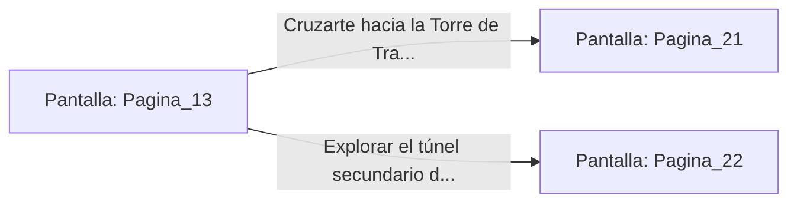

# 📺 Nodo Pantalla: `Pagina_13`

[[Index|⬅️ Índice]] | Fichero Origen: [[sample_eligejuego-code_capitulo_02_mpl|📄 sample/eligejuego-code/capitulo_02.mpl]]

**Narrativa y Encabezado:**
> PÁGINA 13: LA ARMERÍA OLVIDADA
> 
> Utilizas una estaca de titanio de tu equipo para forzar el mecanismo de la verja. Con un chasquido seco, el cerrojo cede y la puerta se abre, revelando un arsenal perfectamente conservado por el vacío neumático de la sala.
> 
> Sobre las estanterías descansan rifles de pulso de fase y escudos de energía reducida. Decides reequipar tu brazalete con una célula de carga adicional antes de explorar la escotilla que conecta directamente con la Torre de Transmisión.

## 📋 Desglose de Instrucciones de Opciones
### `OPCION "Cruzarte hacia la Torre de Transmisión con el equipo mejorado" CON_ACCION TRANSICIONAR_A Pagina_21`
* **Instrucción:** `OPCION` *(Manual: Mapea una entrada o botón interactivo de usuario. Vincular una acción como la invocación de una función C1, un método C2 o una transición C3.)*
* **Efecto de Control:** Dispara `TRANSICIONAR_A` hacia [[Pantalla_Pagina_21|📺 Pagina_21]]
### `OPCION "Explorar el túnel secundario de ventilación de la armería" CON_ACCION TRANSICIONAR_A Pagina_22`
* **Instrucción:** `OPCION` *(Manual: Mapea una entrada o botón interactivo de usuario. Vincular una acción como la invocación de una función C1, un método C2 o una transición C3.)*
* **Efecto de Control:** Dispara `TRANSICIONAR_A` hacia [[Pantalla_Pagina_22|📺 Pagina_22]]

## 📊 Diagrama de Flujo e Interacción (Mermaid)

