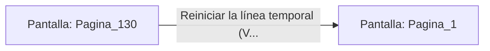

# 📺 Nodo Pantalla: `Pagina_130`

[[Index|⬅️ Índice]] | Fichero Origen: [[sample_eligejuego-code_capitulo_07_mpl|📄 sample/eligejuego-code/capitulo_07.mpl]]

**Narrativa y Encabezado:**
> PÁGINA 130: DESCARGA EN EL ALMACÉN
> 
> Entras al almacén de lingotes de éter sin la protección adecuada. Un arco eléctrico salta desde los bloques energizados, incinerando tu sistema nervioso al instante.

## 📋 Desglose de Instrucciones de Opciones
### `OPCION "Reiniciar la línea temporal (Volver al Inicio)" CON_ACCION TRANSICIONAR_A Pagina_1`
* **Instrucción:** `OPCION` *(Manual: Mapea una entrada o botón interactivo de usuario. Vincular una acción como la invocación de una función C1, un método C2 o una transición C3.)*
* **Efecto de Control:** Dispara `TRANSICIONAR_A` hacia [[Pantalla_Pagina_1|📺 Pagina_1]]

## 📊 Diagrama de Flujo e Interacción (Mermaid)

