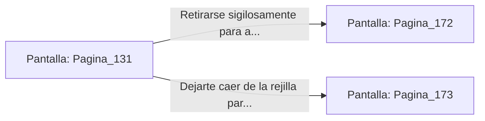

# 📺 Nodo Pantalla: `Pagina_131`

[[Index|⬅️ Índice]] | Fichero Origen: [[sample_eligejuego-code_capitulo_08_mpl|📄 sample/eligejuego-code/capitulo_08.mpl]]

**Narrativa y Encabezado:**
> PÁGINA 131: REUNIÓN DE LOS OFICIALES
> 
> Permaneces inmóvil sobre la rejilla de ventilación, ajustando el captador de audio de tu Brazal de Convergencia. Abajo, en la mesa táctica de la sala de mapas, los dos oficiales de Malakor discuten acaloradamente sobre el despliegue de los escuadrones en el Segundo Sello de Fase.
> 
> Escuchas cómo uno de los comandantes revela el código numérico que desactiva los reflectores del Jardín Sintético, además de confirmar que la guarnición del flanco este se encuentra seriamente desabastecida por los recientes sabotajes.
> 
> Con los datos estratégicos grabados en la memoria de tu dispositivo, te planteas si retirarte en silencio para aprovechar la debilidad del flanco este o dejarte caer para capturar al comandante de mayor rango.

## 📋 Desglose de Instrucciones de Opciones
### `OPCION "Retirarse sigilosamente para atacar el flanco este desabastecido" CON_ACCION TRANSICIONAR_A Pagina_172`
* **Instrucción:** `OPCION` *(Manual: Mapea una entrada o botón interactivo de usuario. Vincular una acción como la invocación de una función C1, un método C2 o una transición C3.)*
* **Efecto de Control:** Dispara `TRANSICIONAR_A` hacia [[Pantalla_Pagina_172|📺 Pagina_172]]
### `OPCION "Dejarte caer de la rejilla para capturar e interrogar al comandante" CON_ACCION TRANSICIONAR_A Pagina_173`
* **Instrucción:** `OPCION` *(Manual: Mapea una entrada o botón interactivo de usuario. Vincular una acción como la invocación de una función C1, un método C2 o una transición C3.)*
* **Efecto de Control:** Dispara `TRANSICIONAR_A` hacia [[Pantalla_Pagina_173|📺 Pagina_173]]

## 📊 Diagrama de Flujo e Interacción (Mermaid)

