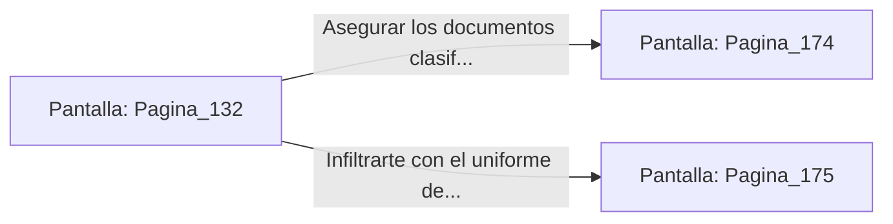

# 📺 Nodo Pantalla: `Pagina_132`

[[Index|⬅️ Índice]] | Fichero Origen: [[sample_eligejuego-code_capitulo_08_mpl|📄 sample/eligejuego-code/capitulo_08.mpl]]

**Narrativa y Encabezado:**
> PÁGINA 132: ATAQUE SORPRESA DESDE EL TECHO
> 
> Abres el enganche de la parrilla de ventilación y caes pesadamente sobre la mesa táctica, desarmando al primer oficial con el impacto de tus botas. El segundo saca apresuradamente su pistola de plasma, pero logras desviarle el brazo a tiempo.
> 
> Tras una breve y feroz lucha cuerpo a cuerpo, dejas a ambos comandantes inconscientes y aseguras los documentos clasificados de la mesa.

## 📋 Desglose de Instrucciones de Opciones
### `OPCION "Asegurar los documentos clasificados y huir hacia los Jardines" CON_ACCION TRANSICIONAR_A Pagina_174`
* **Instrucción:** `OPCION` *(Manual: Mapea una entrada o botón interactivo de usuario. Vincular una acción como la invocación de una función C1, un método C2 o una transición C3.)*
* **Efecto de Control:** Dispara `TRANSICIONAR_A` hacia [[Pantalla_Pagina_174|📺 Pagina_174]]
### `OPCION "Infiltrarte con el uniforme de uno de los oficiales" CON_ACCION TRANSICIONAR_A Pagina_175`
* **Instrucción:** `OPCION` *(Manual: Mapea una entrada o botón interactivo de usuario. Vincular una acción como la invocación de una función C1, un método C2 o una transición C3.)*
* **Efecto de Control:** Dispara `TRANSICIONAR_A` hacia [[Pantalla_Pagina_175|📺 Pagina_175]]

## 📊 Diagrama de Flujo e Interacción (Mermaid)

