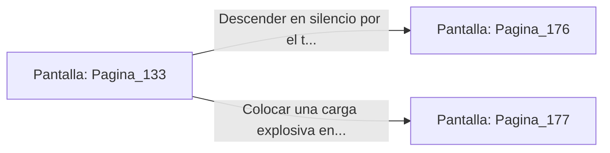

# 📺 Nodo Pantalla: `Pagina_133`

[[Index|⬅️ Índice]] | Fichero Origen: [[sample_eligejuego-code_capitulo_08_mpl|📄 sample/eligejuego-code/capitulo_08.mpl]]

**Narrativa y Encabezado:**
> PÁGINA 133: LA CÚPULA DE LA SALA DEL TRONO
> 
> Avanzas con paso firme por la crestería de pizarra hasta alcanzar la majestuosa cúpula de cristal reforzado que coronaba la Sala del Trono. La tormenta de éter exterior proyecta un sobrecogedor juego de luces violetas a través del vitral entintado.
> 
> Al mirar hacia el interior desde la cornisa superior, divisas a la distancia al Inquisidor Malakor postrado en su trono de obsidiana, canalizando la energía del Núcleo a través de su armadura de fase.
> 
> Un tragaluz de mantenimiento en el lateral de la cúpula te ofrece dos alternativas: colarte por las galerías superiores de los balcones o colocar una carga para volar el vitral por sorpresa.

## 📋 Desglose de Instrucciones de Opciones
### `OPCION "Descender en silencio por el tragaluz lateral hacia los balcones" CON_ACCION TRANSICIONAR_A Pagina_176`
* **Instrucción:** `OPCION` *(Manual: Mapea una entrada o botón interactivo de usuario. Vincular una acción como la invocación de una función C1, un método C2 o una transición C3.)*
* **Efecto de Control:** Dispara `TRANSICIONAR_A` hacia [[Pantalla_Pagina_176|📺 Pagina_176]]
### `OPCION "Colocar una carga explosiva en el vitral para irrupción frontal" CON_ACCION TRANSICIONAR_A Pagina_177`
* **Instrucción:** `OPCION` *(Manual: Mapea una entrada o botón interactivo de usuario. Vincular una acción como la invocación de una función C1, un método C2 o una transición C3.)*
* **Efecto de Control:** Dispara `TRANSICIONAR_A` hacia [[Pantalla_Pagina_177|📺 Pagina_177]]

## 📊 Diagrama de Flujo e Interacción (Mermaid)

