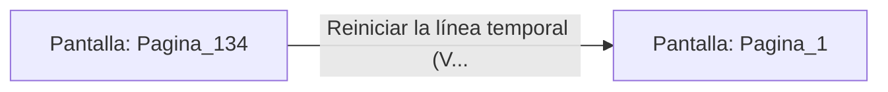

# 📺 Nodo Pantalla: `Pagina_134`

[[Index|⬅️ Índice]] | Fichero Origen: [[sample_eligejuego-code_capitulo_08_mpl|📄 sample/eligejuego-code/capitulo_08.mpl]]

**Narrativa y Encabezado:**
> PÁGINA 134: EL RUPTURA DE LA PASARELA
> 
> Intentas cruzar la pasarela de servicio hacia el Campanario, pero la estructura corroída por el viento de éter se colapsa. Caes desde cincuenta metros de altura sobre las picas de la muralla.

## 📋 Desglose de Instrucciones de Opciones
### `OPCION "Reiniciar la línea temporal (Volver al Inicio)" CON_ACCION TRANSICIONAR_A Pagina_1`
* **Instrucción:** `OPCION` *(Manual: Mapea una entrada o botón interactivo de usuario. Vincular una acción como la invocación de una función C1, un método C2 o una transición C3.)*
* **Efecto de Control:** Dispara `TRANSICIONAR_A` hacia [[Pantalla_Pagina_1|📺 Pagina_1]]

## 📊 Diagrama de Flujo e Interacción (Mermaid)

