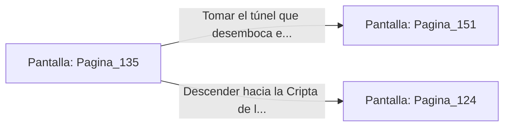

# 📺 Nodo Pantalla: `Pagina_135`

[[Index|⬅️ Índice]] | Fichero Origen: [[sample_eligejuego-code_capitulo_08_mpl|📄 sample/eligejuego-code/capitulo_08.mpl]]

**Narrativa y Encabezado:**
> PÁGINA 135: ASEGURANDO LOS GENERADORES
> 
> Con los anillos de bronce detenidos, aseguras los paneles de control bloqueando las llaves de conmutación mediante tu estaca rúnica. La ausencia del zumbido eléctrico sume a la inmensa cámara en un profundo y pesado silencio.
> 
> Revisas los anaqueles del taller de los técnicos de la planta y descubres dos fusibles de inducción cuántica intactos, indispensables para reactivar los sistemas de defensa de la ciudadela a tu favor.
> 
> Con los componentes a buen recaudo en tu inventario, abandonas la sala por el túnel que comunica con la Armería Principal o con la Cripta.

## 📋 Desglose de Instrucciones de Opciones
### `OPCION "Tomar el túnel que desemboca en la Armería Principal" CON_ACCION TRANSICIONAR_A Pagina_151`
* **Instrucción:** `OPCION` *(Manual: Mapea una entrada o botón interactivo de usuario. Vincular una acción como la invocación de una función C1, un método C2 o una transición C3.)*
* **Efecto de Control:** Dispara `TRANSICIONAR_A` hacia [[Pantalla_Pagina_151|📺 Pagina_151]]
### `OPCION "Descender hacia la Cripta de los Reyes Olvidados" CON_ACCION TRANSICIONAR_A Pagina_124`
* **Instrucción:** `OPCION` *(Manual: Mapea una entrada o botón interactivo de usuario. Vincular una acción como la invocación de una función C1, un método C2 o una transición C3.)*
* **Efecto de Control:** Dispara `TRANSICIONAR_A` hacia [[Pantalla_Pagina_124|📺 Pagina_124]]

## 📊 Diagrama de Flujo e Interacción (Mermaid)

